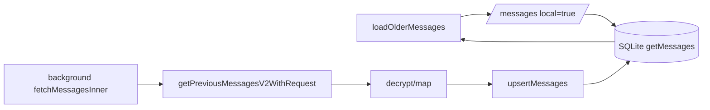
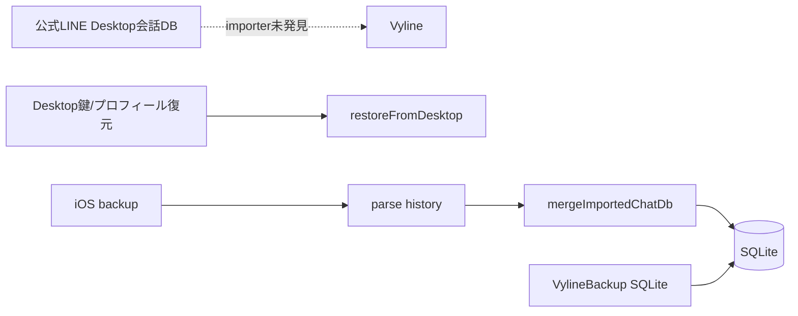
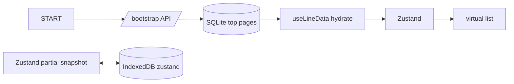
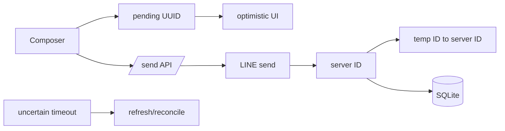
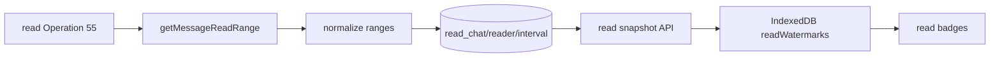
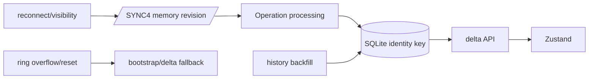

# Vyline Message Engine 全体監査・設計調査

- 調査日: 2026-10-31
- 対象: Vyline Backend、Protocol、SQLite、Desktop React、IndexedDB、履歴・バックアップ取込、既読。
- 方法: ソースコード静的追跡。DB・アカウント・LINE通信へのアクセス、コード変更、テスト実行なし。
- 数値: 性能実測なし。計算量はコード構造からの推定。
- 確信度: 確認済み=コードに存在。一部確認=一部経路のみ。未確認=外部仕様・実環境が必要。

## Part 1 — Executive Summary

VylineはLINE /SYNC4のOperationをBackendで処理し、正規化・復号後にSQLiteへ保存する。履歴RPCも同じ保存系へ合流する。UIはHTTP API、定期poll、Zustand、仮想リストを通る。公式LINE Desktopの会話DBを取り込むコードは見つからなかった。Desktopからの鍵・プロフィール復元と、iOSバックアップ/VylineBackupの履歴取込は別機能。

重大な発見:

1. UIの過去ページ取得はlocal:trueでSQLite限定。スクロールだけではLINE履歴RPCを呼ばず、DB未収録の履歴は補完されない。
2. SYNC4 revisionはaccount単位のメモリ上にあり、Operation処理前に進む。処理失敗はログ後に続行し、durable checkpoint/retryは確認できない。
3. 複数sourceの重複はaccount/chat/messageの複合主キーで抑止するが、一般フィールドをsource/revisionで調停する統一規則はない。
4. SQLite通常経路は変更なしを省く一方、messageごとのmetadata/readers/reactions/historyは削除・再挿入する箇所がある。dirty経路は全チャットをメモリへ展開する。
5. ReactのDOMは仮想化されるが、受信merge、selector、仮想index計算は表示中メッセージ数に比例する。
6. Read Engine v4のコードは存在する。LINE既読rangeの連続性・意味、実DB移行、実測性能は未確認。

## Part 2 — 100項目

表記: 各項目を「現状; 根拠; 問題/改善; 確信度」の順で記載。根拠は相対パス:行番号 / 関数名。

### A. 全体構造

1. モジュール: Backend line/service/storage/api、Protocol、Desktop lib/hooks/components、types。根拠: backend/src/service/lineService.ts、apps/desktop/src/lib/store.ts。境界を文書化; 確認済み。
2. BackendはRPC・復号・永続化・BFF、Desktopは画面/状態、ProtocolはThrift transport。根拠: backend/src/api/line.ts、packages/protocol/stack/base/service/talk/mod.ts。DTO境界を共有; 確認済み。
3. LINE受信→Operation処理→map/decrypt→upsert→event poll→Zustand→chat-area。根拠: clientManager.ts:208-289、lineService.ts:3248+、talkEventBuffer.ts、store.ts:2342+。各段計測; 確認済み。
4. Operation列は順次await、ログ/revoke等に非同期副作用。根拠: lineService.ts:3248+。revokeのfire-and-forget順序を明確化; 一部。
5. LINE Thrift HTTP、UI間はHTTP polling。message用WS/SSEなし。根拠: talk/mod.ts:22-87、api/line.ts:454,478。poll latency計測; 確認済み。
6. 正本/状態はLINE、SQLite、Backendメモリ、Zustand、IndexedDBに分散。根拠: talkEventBuffer.ts、store.ts:2770-2782。フィールド単位正本表; 確認済み。
7. 本文正本はローカルSQLite、LINEサーバー状態はLINE。既読にv4/旧reader/IndexedDB cache併存。新鮮度/source不足; 確認済み。
8. 起動はaccount/client→SQLite→bootstrap→Desktop hydrate/sync。全画面初期化順は一部不明。useLineData.ts、useVylineSync.ts; 起動sequence試験; 一部。
9. ops loopはAbortController/timer停止、UI hook cleanup。clientManager.ts:208-292。stop時cursorは消える; 確認済み。
10. lineService.ts/chatStore.tsがRPC・正規化・状態・保存を集約。測定後に小さく分割; 確認済み。

### B. リアルタイム受信

11. TalkService.sync /SYNC4。Type 26 message、55 read、64/65 destroy。talk/mod.ts:22-87、line_types.ts:1170+; 確認済み。
12. requestはrevision/global/individual。opsRevisionはaccountごとのメモリMap。clientManager.ts:50-59,208-289; DB checkpoint呼出なし; 確認済み。
13. 起動時開始、通常poll 2s/idle 8s、timeout 60s、limit 100、backoff 5–60s。clientManager.ts:208-289。再ログインcursor仕様は未確認。
14. Operationはrevision,createdTime,type,reqSeq,checksum,status,param1-3,message。line_types.ts:12095-12107。例: type 26, revision <int64>, message id <id>; 機密値なし; 確認済み。
15. 配列順に逐次処理。LINEの順序保証は未確認。lineService.ts:3248+。逆順/replay fixture; 一部。
16. PKは重複行を阻止するが副作用/eventは重複し得る。chatStoreRelational.ts:44-53。idempotency key; 一部。
17. event ringへpush後にupsertする経路がある。lineService.ts:3290+。UI通知がDB commit先行し得る; commit後publish; 確認済み。
18. cursorはOperation処理前に進み、operation失敗はcatch/logして続行。clientManager.ts:208-289、lineService.ts:3248+。再処理保証なし; 重大; 確認済み。
19. map/decrypt/DB失敗後に保存されない可能性。LINE側再送は未確認。durable inbox/checkpoint; 一部。
20. account単位loop/revision/DB key。複数account公平性・同時数上限不明。account queue; 一部。

### C. 履歴・外部Desktop

21. 取得元はlive Operation、LINE previous RPC、iOS backup、VylineBackup、旧Vyline JSON移行、SQLite。lineService.ts:785+,3568+、iosBackupService.ts、backupService.ts、chatStore.ts:200+; 確認済み。
22. 公式LINE Desktop会話DB取込は未発見。restoreFromDesktopは鍵/プロフィール。restoreDesktop.ts:163+、api/line.ts:1477-1481。網羅証明不可; 一部。
23. Vyline UI履歴はBackend SQLite経由、IndexedDBはZustand設定状態。indexedDbStorage.ts、useLineData.ts; 確認済み。
24. getPreviousMessagesV2WithRequest: messageBoxId,endMessageId,messagesCount。lineService.ts:785+; 確認済み。
25. bootstrapは上位12 chat×40、account indexは上位20×40。chatStore.ts:957+、lineService.ts:5805+。全履歴ではない; 確認済み。
26. cursorはmessage box last-delivered ID/before ID/time。lineService.ts:3568-3664、useLineData.ts:283-296。synthetic fallbackと終端の混同注意; 一部。
27. synced metadata/hasMoreはあるが「全履歴取得済み」の保証stateは未確認。chatStoreRelational.ts:102+; 確認済み。
28. 複数sourceは複合PK統合、iOSは既存を優先。source rankなし。chatStore.ts:1265+; 一部。
29. history/live同一IDは重複しないがwrite順で未規定フィールドが競合。chatStore.ts:444+; race permutation test; 一部。
30. older UI APIはlocal:true、SQLiteのみ。useLineData.ts:275-319。ローカル外履歴はscrollで取得しない; 重大; 確認済み。

### D. ID・正規化

31. 一意キー(account,chat,message)。chatStoreRelational.ts:44-53; 確認済み。
32. message IDは文字列化したInt64系、SQLは長さ+辞書順で数値順。時系列保証は未確認。chatStoreRelational.ts:55-60、lineService.ts:3068+; 一部。
33. created/delivered時刻と観測時刻は別箇所。line_types.ts:11490+、readEngineV4.ts。明確な定義をAPI化; 一部。
34. SQL created_time/idとUI sortで順序復元。到着順に依存しない。chatStoreRelational.ts:55+; server保証未確認。
35. UI pending UUIDをserver IDに置換。lineService.ts:3987+、store send actions。timeout後server成功重複照合不明; 一部。
36. LINE mapper、iOS mapper、Desktop mapperが別。lineService.ts:3068+、iosBackupService.ts、mappers.ts。共通canonical DTO; 確認済み。
37. 本体とmetadata/readers/reactions/historyは別テーブル、snapshot/tombstoneも別。chatStoreRelational.ts:34-106; 確認済み。
38. read/revoke保護はあるが、他field全てsource-awareではない。chatStore.ts:337+,1265+; 古い本文/metadata上書きリスク; 確認済み。
39. 欠損値mapper処理あり、quarantineは未確認。lineService.ts:3068+; 不正fixture/隔離指標; 一部。
40. 重複処理はDB PK、history Map、UI Map、import mergeに分散。共通identity規則; 確認済み。

### E. SQLite

41. records/messages/tombstones/snapshots/metadata/readers/reactions/history/account_state/box_order/synced/local_read。chatStoreRelational.ts:34-108; 確認済み。
42. v4はread_chat_v4/read_reader_v4/read_interval_v4。readEngineV4.ts:165-190; 役割はrange/source/version; 確認済み。
43. message本体upsert+関連表操作+sync timestamp。chatStoreRelational.ts:197-263、chatStore.ts:444+。SQL数未計測; 確認済み。
44. clean pathはexistingをmergeし等価ならskip。ただしsync time別更新。chatStore.ts:444+; SQL計測; 確認済み。
45. 無変更本体writeを省くがmeta/dirty pathで更新あり。chatStore.ts、chatStoreRelational.ts; 確認済み。
46. child tablesはmessage単位DELETE→INSERT、meta/box orderも全置換箇所。chatStoreRelational.ts:197-263; 確認済み。
47. clean batchはtransaction、dirty pathは400ms coalesce。chatStore.ts:444+; single incomingは1件transactionになり得る; 確認済み。
48. WAL、NORMAL、foreign_keys ON、busy_timeout 5000。sqlite.ts:15-54、sqliteConfig.ts。custom cache/checkpointなし確認; 確認済み。
49. bulkでは復号Promise.all、batch DB、index更新。lineService.ts:3568+; 実測なし; 一部。
50. backup SQLite別管理、message logs bounded。通常履歴保持/VACUUM運用は未確認。backupService.ts、messageLog.ts; 一部。

### F. 統合・整合性

51. SQLite merge=upsertMessages、import=mergeImportedChatDb、UI=mergeIncomingMessages。chatStore.ts:444+,1265+、store.ts:2342+; 確認済み。
52. readBy union/count max/seen max、revoke保護、iOS existing-first。一般fieldはversionなし。chatStore.ts:337+; 確認済み。
53. count maxは巻き戻り防止だが訂正も反映しない。本文/metadataは古い上書き可能; 確認済み。
54. revoke/read/reaction一部別扱い、全fieldで独立mergeではない。lineService.ts/chatStore.ts; 一部。
55. SQLiteは本文、IndexedDBはZustand部分snapshot/watermark。indexedDbStorage.ts、store.ts:2770-2782; 確認済み。
56. v4にsource/observed/version/stale、他cache共通TTLではない。readEngineV4.ts:167-172; 一部。
57. API response/chat generation guardあり、全体競合プロトコルはなし。useLineData.ts/store.ts; 一部。
58. visibility復帰時差分sync、ring reset時fallback。useVylineSync.ts/talkEventBuffer.ts; server replay保証不明。
59. SQLite account keyで分離。複数window通知・同時書込保証は不明。busy timeoutあり; 一部。
60. transactionは途中失敗を保護、event ringはメモリ限定、cursor非永続。確認済み。LINE replay不明。

### G. ライフサイクル

61. contentType/metadataはmessageと子表、実mediaは別cache。types/index.ts:142+、relational schema; 全type網羅は一部。
62. media URL/metadataと実ファイルの保存は別。lineService media handlers; lifecycleごとに調査必要。
63. media retry/capは機能ごとに存在、全typeの容量規則未確認。lineService/settings; 一部。
64. optimistic pending→server IDまたはerror/uncertain。lineService.ts:3987+; 確認済み。
65. timeout後server成功のidempotencyは未確認。send path; duplicate retry risk; 一部。
66. remote revokeはsnapshot/state、local deleteはtombstone。chatStore/lineService; 確認済み。
67. revoked upsert保護、local tombstoneで削除復活を防ぐ。backup snapshotは独立。chatStore; 確認済み。
68. reactions/related id/mentions/historyを型・子表で保持。types/index.ts、lineService.ts、schema; 一部。
69. membershipはchat/contact側。過去メンバーsnapshotを各messageに持つか未確認。
70. SQLite FTSなし。chat-area検索はロード済みchatMessagesを走査。chat-area.tsx:185+; unloaded履歴は検索対象外; 確認済み。

### H. UI / React

71. Zustandにchat list/current messages/readWatermarks/preferences。store.ts:477+; 確認済み。
72. page size 100、bootstrap 12×40、index 20×40。ただしdirty backend loadは全DB memory化。useLineData.ts、chatStore.ts; 確認済み。
73. IndexedDB store zustandにstructured-clone snapshot、localStorageはlegacy fallback。indexedDbStorage.ts:3-19,159-193; 確認済み。
74. chat-area selectorで対象会話を読む。React commit数は未計測。
75. incoming mergeはfilter/map/Set、reaction JSON stringify、st.messages map。store.ts:2351-2425; O(n)候補; 確認済み。
76. useVirtualListはoverscan 10/ResizeObserver/binary search、index offsets全行計算。chat-area.tsx/useVirtualList.ts; 確認済み。
77. prepend時anchor維持処理あり、実画面未検証。useLineData.ts:310-319; local-only制約あり。
78. bootstrap→hydrate→network load、generation/chat guard、初期scrollは2 animation frames。chat-area.tsx:446-464、useLineData.ts; 確認済み。
79. array scan/sort、virtual offset、画像/反応。Profiler未実施; 性能候補。
80. selector cacheはarray参照依存。全messages配列更新で再計算し得る。store.ts/chat-area.tsx; 確認済み。

### I. 既読

81. Type 55/read eventからrange API、normalize/cache/v4。lineService.ts、readEngineV4.ts。サーバー意味は未確認。
82. legacy readers/count + v4 ranges + IndexedDB watermarks。chatStoreRelational.ts:78-86、readEngineV4.ts:165-190; 確認済み。
83. seen/read_count/readBy/readWatermarksは意味が別、画面ごとの優先順位は完全棚卸し未了。types/store; 一部。
84. Thrift enum 55はNOTIFIED_READ_MESSAGE。reaction 139/140/154別処理。line_types.ts:1170+、lineService.ts; 現衝突の証拠なし; 確認済み。
85. rangeにstart/end IDs/time。連続区間の意味はコードから確認できず。line_types.ts:14530-14540; 未確認。
86. count-only証拠から読者推定はしていない設計が必要。表示分岐全画面未確認; 一部。
87. 旧readerはmessage×reader行、v4はinterval数相当。SQL計測なし。
88. self local readとpeer rangesは別系統。chat_local_read、sendChatChecked path; 一部。
89. historyとrange fetchが重なる。monotonic mergeは巻戻り防止する一方、訂正/削除に弱い。chatStore.ts:337+; 確認済み。
90. v4 migrationは旧明示reader/rangeを対象。実DB移行未実行。readEngineV4.ts:165-206; 一部。

### J. 性能・テスト

91. map/dedupは概ねO(n)、sort O(n log n)、配列merge O(n)。実測なし。
92. 候補はchild DELETE/INSERT、decrypt展開、UI full scan、JSON stringify、polling。全て未計測。
93. duplicate costはselect+merge+PKとUI Map/Set。実測なし。
94. Dirty trackingは既に等価チェックあり。hash導入は小データでは逆効果もあり測定必須。
95. batch transactionあり、Operation逐次処理、HTTP poll。bounded decrypt concurrencyなど候補; 一部。
96. API page/chunkあり。一方dirty DB全展開、decrypt batch materialization。chatStore/lineService; 確認済み。
97. intervalはreadデータを圧縮し得るが、正確性/索引コストを測る必要。実測なし。
98. tests: chatStore.sqlite.test.ts, chatStore.readState.test.ts, lineService.readReceipts.test.ts, store.sync.test.ts, indexedDbStorage.test.ts。cursor crash/source race/100k UI coverage不在を確認。実行なし。
99. temp DBで10k/100k/1M件、1/100 readers、RPC payload replay、React Profiler、memory/DB/WAL bytesを測る。実測なし。
100. 優先はdurable checkpointと履歴ページremote gap、次に差分子表書込/UI全件走査。Q18/Q30/Q43/Q75根拠。設計提案。

## Part 3 — データ構造・フロー図

主要型: Thrift Operation line_types.ts:12095-12107、Message line_types.ts:11490+、共有Message packages/types/src/index.ts:142+。message IDは文字列化Int64系、chat/accountで分離。created/delivered/observedAtは別概念。JS Number変換の精度境界を確認すること。SQLite主キーはaccount/chat/message。Zustand persist対象に本文履歴は含まれない。

Schema:
- chat_message_tombstones_v2(account,chat,message)
- chat_records_v2(account,mid)
- chat_messages_v2(account,chat,message)、created-time/ID order index
- chat_message_snapshots_v2
- chat_message_metadata_v2(account,chat,message,owner,key)
- chat_message_readers_v2(account,chat,message,owner,position)
- chat_message_reactions_v2 / chat_message_history_v2
- chat_account_state_v2、chat_box_order_v2、chat_messages_synced_v2、chat_local_read_v2
- read_chat_v4(account,chat)、read_reader_v4(account,chat,reader)、read_interval_v4(account,chat,reader,start,end)
根拠: backend/src/storage/chatStoreRelational.ts:34-108、readEngineV4.ts:165-190。

### 1. live受信から画面

```mermaid
flowchart LR
 L[LINE /SYNC4] --> C[startFetchOpsLoop]
 C --> O[processFetchedOperations]
 O --> M[processSingleOperation map/decrypt]
 M --> U[upsertMessages]
 U --> DB[(SQLite)]
 M --> E[talkEventBuffer]
 E --> P[/events/poll HTTP]
 P --> Z[Zustand mergeIncomingMessages]
 Z --> R[chat-area virtual list]
```

### 2. 履歴ページと別background fetch



UI olderページはLINE RPCに直結しない。

### 3. 外部データ



### 4. 起動復元



### 5. 送信



### 6. 既読



### 7. 再接続/重複排除



### 競合シナリオの要点

- 履歴/live同一ID: PKで一行。ただし順序未規定fieldはlast write競合。
- 3 source: DB PK重複抑止、iOS existing-first。sourceごとのfield policyはない。
- 古い既読: readBy union/maxは巻戻りを防ぐが訂正/reader削除も表現できない。
- 取消し後履歴: revoked保護とlocal tombstone。バックアップsnapshotは別データ。
- 応答順逆転: ID dedup、createdTime/IDで表示。未バージョンfieldは競合可能。
- DB直前crash: transaction rollback想定だがcursor先行。server replay仕様未確認。
- DB成功/UI通知失敗: DBに残る。再open時DB fetchで回復できるが即時通知は欠落し得る。
- offline: ring最大400。overflow時reset/fallback。
- group read storm: legacy per-message readersは人数に応じて増加、v4はrange数に依存。
- account切替: account key/guardあり。遅延応答を使った網羅試験なし。
- IndexedDB quota/破損: localStorage fallback読込、snapshot write errorは握りつぶす箇所あり。
- SQL途中失敗: transaction範囲はatomic。dirty flush/import各経路の注入試験が必要。

## Part 4 — 候補比較

| 方式 | 正確性 | 読取/書込 | メモリ/容量 | 移行/保守 |
|---|---|---|---|---|
| 現行 | 既存互換高、source衝突規則不足 | page良好、child全置換あり | dirty path高 | 低 |
| 差分UPSERT+Dirty Tracking | field policy次第で高 | child差分で削減 | 小 | 中 |
| 正規化store+派生view | 正本明確 | join/派生更新コスト | payload削減 | 高 |
| Incremental Materialized View | 差分正しければ高 | read高速/write複雑 | 派生容量増 | 高 |
| 単一writer queue+batch tx | 順序/再試行向上 | batch効率、遅延調整要 | bounded queue | 中 |
| revision/cursor sync | durable化で欠落低減 | 再取得削減 | 小 | LINE仕様依存 |
| Multi-source reconciliation | provenanceにより高 | merge負荷 | 小metadata増 | 高 |
| chat cache分割 | cross-chat誤更新低減 | 局所更新 | bounded可 | 中 |
| CQRS/Event Sourcing/CRDT | 要件次第、全面は過剰 | 経路増 | event容量増 | 高 |
| Read Engine v4 | range evidence保持 | interval件数次第 | 旧行より圧縮可能 | 中・仕様検証要 |

## Part 5 — 推奨vNext

1. Durable Operation checkpointはOperation永続化後にcommit。LINE cursor境界を先に実証。
2. 一つのcanonical upsert入口をlive/history/iOS importで共有し、source/observedAtを保持。本文・read・revoke等のfield別merge規則を定義し、単純なtimestamp最大化を避ける。
3. UIのlocal履歴枯渇時にremote previous RPCを呼ぶ。hasMore/終端/未取得/失敗を別stateにする。
4. SQL write counterを先行導入し、子表の差分UPSERT。完全snapshotの意味がない削除はしない。
5. Read v4はサーバーrangeをそのまま証拠として保存。連続性を仮定せず、count-onlyからreaderを推定しない。shadow compare後に有効化。
6. SQLite commit後のoutbox/event cursorをHTTP pollに利用。ringは高速cacheとして残し、overflowはDB deltaで復帰。
7. frontendはchat単位page cache/id map/差分selector。未ロード履歴検索はSQLite検索APIとして別設計。
8. decrypt/importをchunk化、DB writerをbounded queue化。上限は計測で決定。
9. SQLiteを複数window共通正本とし、event cursorとaccount generationで同期。
10. 段階移行: shadow計算→旧新差分記録→v4/API切替→期間観測→旧表廃止判断。削除は別段階。

## Part 6 — ロードマップ

| 段階 | 対象/作業 | 検証 | rollback |
|---|---|---|---|
| 0 計測 | clientManager/lineService/chatStore/UIにlatency・SQL数 | offline synthetic fixture | 計測flag off |
| 1 正確性 | durable checkpoint、commit後event、retry | crash/replay/duplicate | 旧loopへ戻す |
| 2 履歴 | useLineData/API/lineService remote paging | cursor境界、ローカル終端、再試行 | backfill flag off |
| 3 統合/DB | canonical source merge、child差分書込 | 3-source permutations、atomicity | 旧upsert flag |
| 4 既読 | v4 shadow、read range意味検証 | old/new比較、移行rollback | 旧reader read |
| 5 UI | store/chat-area/useVirtualList差分化 | 100k fixture、Profiler、scroll anchor | selector単位 |
| 6 import/運用 | iOS/backup streaming、復旧 | quota/破損/backup/restore | importer停止、原本維持 |

### 計測計画

Receive latency: Operation受信→Backend認識。Persist:受信→SQLite commit。UI:受信→React commit。各々monotonic clockでspan ID相関。SQL writesはSQLite statement/transaction counter。DB sizeはDB/WAL bytes。Memory/CPUは起動・履歴ページ・大量受信のプロセス計測。RPC countはchat/account別。React commitsはProfiler。Consistencyは重複/欠落/状態不一致fixtureで数える。**全指標は本調査では未計測**。benchは一時DBに10k/100k/1M message、1/100 reader、offline payload replayで実施し、実ユーザーDB不要。

## 追加検証

1. SYNC4 cursorがexclusive/inclusiveか、失敗Operationが再送されるかを安全な受信ログで確認。
2. DM/group getMessageReadRangeのrange意味、参加/退出/欠落との関係をcontrolled captureで検証。
3. 一時SQLiteで1/100件保存のSQL数、transaction時間、WAL bytesを測る。
4. IndexedDB blocked/quota/corrupt時の復旧UIを検証。
5. older UIのlocal枯渇時にremote RPCが呼ばれない現状をfixtureで固定する。

## 根拠ファイル索引

- Backend sync/API: backend/src/line/clientManager.ts, talkEventBuffer.ts, backend/src/api/line.ts
- Message service: backend/src/service/lineService.ts
- Persistence: backend/src/storage/chatStore.ts, chatStoreRelational.ts, sqlite.ts, readEngineV4.ts
- Import: backend/src/service/restoreDesktop.ts, iosBackupService.ts, backupService.ts
- Desktop: apps/desktop/src/lib/store.ts, hooks/useLineData.ts, hooks/useVylineSync.ts, components/chat-area.tsx, hooks/useVirtualList.ts, lib/indexedDbStorage.ts
- Types: packages/types/src/index.ts, packages/line-types/line_types.ts, packages/protocol/stack/base/service/talk/mod.ts
- Tests inspected but not run: chatStore.sqlite.test.ts, chatStore.readState.test.ts, lineService.readReceipts.test.ts, store.sync.test.ts, indexedDbStorage.test.ts.

