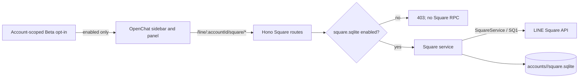

# OpenChat / Square (Beta)

Last updated: 2026-11-04

## Status

OpenChat support is Beta. Vyline makes no Square requests until the user enables **OpenChat** in Settings > Beta Features and records consent. While disabled, only the local account-scoped SQLite flag is read.

The current implementation lists joined OpenChats/rooms, searches OpenChats, fetches messages for a selected room, and sends text. It also supports thread reading/text replies, read-only member roles, and lazy image/video/audio previews after matching the HAR with the existing protocol implementation. It uses a separate `/SQ1` BFF path, UI, and database from regular Talk `/S4`, Chat, Message, and read-state code.

Media attachment sending, note content, read receipts, reactions, role/admin actions, live talk, and room join/leave are not implemented. OpenChat threads have not been proven equivalent to ordinary subrooms, so the UI handles thread references only.

## Data flow

Square identifiers never enter the regular Talk chat/message model or Talk API. Room IDs (`squareChatMid`) and parent Square IDs (`squareMid`) remain distinct.

## Opt-in and network schedule

- New accounts default to `square_settings.enabled=0`.
- The account-scoped SQLite flag is enabled only after the device consent ledger is saved.
- Enabling immediately fetches the joined list. While the app is visible, the list refreshes at most every five minutes.
- A room's events are requested when that room is opened and then every 60 seconds while visible. Other rooms are not scanned in the background.
- Disabling updates the backend flag and generation first. An already dispatched HTTP/RPC call may not be cancellable, but its response is discarded and cannot write to the database or UI; no new Square calls are scheduled.
- Consent history stays in the existing local Beta ledger. Cached content may include messages and profiles, so protect the device and its user account.

## APIs and capabilities

| Capability | Status | Behavior |
| --- | --- | --- |
| Enable status | Implemented | `GET /line/:accountId/square/status` reads local config only |
| Enable / disable | Implemented | Changes the account SQLite flag; generation invalidates in-flight responses |
| Joined list | Implemented | Bounded pagination through `/SQ1` `getJoinedSquares` and `getJoinedSquareChats` |
| OpenChat search | Implemented | `/SQ1` `searchSquares`, query length 2–100, 20 results, one-second server-side interval |
| Room messages | Partial | `/SQ1` `fetchSquareChatEvents`, at most five pages per call, persisted continuation |
| Text send | Implemented | `/SQ1` `sendMessage`, 1.25-second per-room cooldown and SQLite operation UUID |
| Thread read/reply | Partial | Opens only `threadInfo.chatThreadMid` discovered in a parent message. `getSquareThread` must confirm the user's membership is `JOINED` before `sendSquareThreadMessage`; shares per-room cooldown and operation deduplication |
| Members / roles | Read-only | Fetches `getSquareChatMembers` in pages of 100 and caches members by account and room. `ADMIN` gets a blue crown and `CO_ADMIN` an inverted crown; no admin controls are exposed |
| Image/video/audio previews | Partial | Uses the `SquareMessage` Square OBS path and loads lazily near the viewport. Rejects a result larger than 8 MiB after download, so this is not a transfer or pre-allocation limit. Does not fetch message metadata URLs |
| Stickers | Send and receive | HAR showed 11 received stickers and five sticker sends, all with successful responses. The owned-sticker picker now calls a Square-specific API using the existing 1.25-second cooldown and operation UUID dedupe. Rendering uses a fixed CDN origin and numeric ID validation |
| File/image/video/audio sending | Not supported | Protocol has image/video/audio send methods, but the HAR does not establish a Square OBS upload and the file-send contract is unverified. Safe file receive is also absent |
| Read | Explicit manual action | A per-message button calls `markAsRead`, including `threadMid` in a thread. No automatic read or unread-count/watermark integration. HAR recorded 72 `markAsRead` and one `markThreadsAsRead`; full read-position synchronization remains unverified |
| Reactions | Explicit manual action | Per-message buttons send one of six standard types through `reactToMessage`, scoped to a cached room/thread message. Counts/readers, undo, and event reconciliation are absent. HAR recorded three requests, but not complete response/state transitions |
| Role changes / authority | Partial | Displays only `SquareMember.role`. HAR recorded 11 `updateSquareMember` and six `updateSquareChatMember` calls, but their purpose is unknown; admin actions are not implemented |
| Notes | Not supported | HAR contains one `getNoteStatus`; protocol types establish status data only, not note-content fetch/post. Do not equate OpenNote HTTP traffic with Square Note APIs |
| Join / leave / admin | Not supported | HAR recorded five `getJoinableSquareChats`, zero `joinSquareChat`, one `leaveSquareChat`, and one separate `joinSquare`. Join conditions, leave arguments, approval and recovery remain unverified |
| Live talk | Not supported | No `/SQLV1` requests or related `/SQ1` RPCs appeared in this HAR. Protocol types alone do not establish OpenChat wire behavior or audio transport |
| LIFF | Not supported | No assumption that LIFF works inside OpenChat |
| E2EE | Unverified | No Talk E2EE decrypt path was found in the Square message class; do not guess how to decrypt |

### Thread communication verified in the HAR

The supplied ~98 MB HAR was parsed locally with the protocol package's Thrift decoder. Only RPC and field names are documented; values are omitted.

- `/SQ1` contained seven `sendSquareThreadMessage` calls. The request has `reqSeq`, `chatMid`, `threadMid`, and `threadMessage.message`; text requests include `to`, `text`, `contentType` (`NONE`), and `toType` (`SQUARE_THREAD`). The response returns `createdThreadMessage`.
- `getSquareThread`, `getSquareThreadMid`, `joinSquareThread`, `leaveSquareThread`, and `markThreadsAsRead` were each observed once. `getSquareThread` returns `myThreadMember`, which is checked before sending.
- `getSquareChatMembers` was observed three times; its typed response is `SquareMember[]` with a role. LINE Help says the creator becomes the admin and an admin can transfer that role to a co-admin. Vyline uses ADMIN/CO_ADMIN only for display and makes no role-change calls.
- Decodable `fetchSquareChatEvents` responses included content types such as 8 `IMAGE`, 1 `AUDIO`, 1 `FILE`, and 11 `STICKER` messages. The preview path uses the protocol's Square OBS download API and never fetches arbitrary URLs from message metadata. Seeing a type in a HAR does not prove a successful download for every media type.
- Existing Vyline `SquareThreadMessage` code matches the captured request shape. Sending uses the same reqseq and payload shape. The app does not auto-join a thread; only text replies are enabled.
- This is one session capture, not proof of behavior for other accounts, regions, or membership states. No live account send or HAR replay was performed.
- Thread and room events share `(room_id, message_id)` deduplication; thread sync cursors and continuation tokens use a separate state key.

## Sync, deduplication, and deletion

- Per-room `sync_cursor` and `continuation_token` are stored separately. The durable cursor does not advance while pages remain; the next request resumes from the continuation.
- Message identity is `(room_id, message_id)`. An UPSERT with an older Square message revision cannot replace a newer stored revision.
- Destroy events create `(room_id, message_id)` tombstones, preventing older history pages from resurrecting deleted messages.
- Messages are written before the cursor. If the process crashes before cursor advancement, replay is idempotent by message ID.
- Square cursor and continuation semantics are not a published LINE contract, and long-running live-account tests have not been done. Resuming backlogs over five pages and gap-free page boundaries still need fixture tests and an optional test account.

## Database and backups

Each account uses `data/accounts/<safe-account-id>/square.sqlite`, separate from normal chat storage. Main tables:

- `square_settings`: Beta state
- `square_entities`: Square / room / member JSON cache
- `square_messages`: message cache keyed by room ID and Square message ID
- `square_message_tombstones`: prevent resurrection after deletion
- `square_room_sync_state`: per-room cursor and continuation token
- `square_send_rate`, `square_send_operations`: room send pacing and duplicate-operation prevention; message text is not stored here

WAL mode and `synchronous=NORMAL` are used. Compatibility with normal VylineBackup, iOS restore, and Desktop restore has not been verified, so the Square database is currently excluded from those backups. History reads and sends accept only room IDs present in the locally cached joined-room list.

## Rate protection

LINE's published Messaging API limits do not define the private `/SQ1` Square RPC limits. Vyline applies a local safety policy: at most one send per room every 1.25 seconds; sends in different rooms are not globally serialized. A client operation UUID is reserved in SQLite before the request, so retrying the same operation after a lost HTTP response cannot send it twice. Search requests have a one-second per-account minimum interval.

These are Vyline safeguards, not LINE-published thresholds or a way to bypass limits. On server errors or restriction responses, reduce retries and disable the feature if the account is affected.

## Scope, official references, and HAR

This investigation and implementation scope is limited to Japanese public materials and the supplied HAR. Taiwan and Thailand are explicitly out of scope; no compatibility claim is made for them.

Official guidance treats normal subchats and message threads as distinct features. Vyline currently handles only threads discovered from a parent message's `chatThreadMid`; subchat hierarchy is not classified. The UI does not enforce the official thread creation/reply time windows, so the server remains authoritative. Thread directory and favorites are also absent. Since LINE does not officially support LIFF apps inside OpenChat, Vyline does not launch LIFF from the OpenChat UI.

The HAR is about 98 MB and is not committed. A local read-only inventory found 5,303 total requests and 1,088 `/SQ1` requests. RPC-name counts: `markAsRead` 72, `markThreadsAsRead` 1, `reactToMessage` 3, `getNoteStatus` 1, `getJoinableSquareChats` 5, `joinSquareChat` 0, `leaveSquareChat` 1, and `sendSquareThreadMessage` 7. Five sticker sends had `STKPKGID`, `STKID`, `STKVER`, and `STKOPT` fields and all five responses succeeded. Other counts show recorded requests, not successful responses, complete state transitions, or reproducibility across accounts. No HAR values, cookies, tokens, user IDs, message text, or URL query values are documented. Finding `LIFF1` traffic does not prove that it belongs to OpenChat settings. LINE Developers says LIFF apps are not officially supported inside OpenChat.

References:

- [LINE OpenChat guide](https://guide.line.me/ja/services/openchat.html)
- [LINE Help: OpenChat availability](https://help.line.me/line/smartphone?a8=.V&contentId=20014753&lang=en)
- [LINE Help: OpenChat subchats and sync](https://help.line.me/line/?contentId=20024116&lang=ja)
- [LINE Help: Threads](https://help.line.me/line/smartphone?contentId=20027219&lang=ja)
- [LINE Help: Reactions](https://help.line.me/line/?contentId=20020725&lang=ja)
- [LINE Help: Live Talk](https://help.line.me/line?contentId=20024812&lang=ja)
- [LINE Help: OpenChat admin permissions](https://help.line.me/line/?contentId=20005393&lang=ja)
- [LINE Help: Notes in chats](https://help.line.me/line/?contentId=20000246&lang=en)
- [LINE Developers: LIFF overview and OpenChat limitation](https://developers.line.biz/ja/docs/liff/overview/)
- [LINE Developers: Messaging API rate limits](https://developers.line.biz/en/tips/2026/09/10/messaging-api-rate-limits/) — this does not publish Square RPC limits

## Rollback

Turn OpenChat Beta off to stop future Square traffic. When rolling back to a version that does not understand this schema, keep `square.sqlite`; do not delete it. There is no user-facing cache deletion control or API. If manually removing the cache, exit the app and handle the DB, WAL, and SHM files together.
