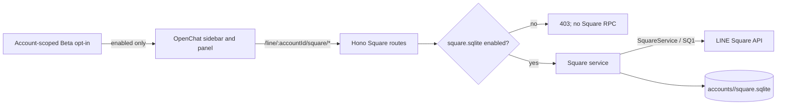

# OpenChat / Square (Beta)

Last updated: 2026-11-05

## Status

OpenChat support is Beta. Vyline makes no Square requests until the user enables **OpenChat** in Settings > Beta Features and records consent. While disabled, only the local account-scoped SQLite flag is read.

The current communication implementation is **experimental and based on a HAR captured from a primary device**. Secondary-device compatibility is unverified, so use is not recommended. Enabling and operating it are at the user's own discretion and risk. We plan to capture traffic on secondary devices later, verify device differences, and improve stability.

The implementation uses a separate `/SQ1` BFF path, UI, and database from regular Talk `/S4`, Chat, Message, and read-state code. HAR-observed RPCs are distinguished from RPCs present in the implementation but absent from the capture; the latter are not treated as HAR-verified behavior. Current features include joined-room message viewing, text/sticker sending, thread viewing/replies, member-role display, lazy image/video/audio previews, manual read, standard reactions, private room creation, invitation URL retrieval, and announcement listing/creation/deletion. Attachment sending, note content, role/admin changes, live talk, and room join/leave remain unsupported or unverified.

OpenChat threads and ordinary subchats are separate features; Vyline currently handles only message threads, not subchat hierarchies.

## Data flow



Square identifiers never enter the regular Talk chat/message model or Talk API. Room IDs (`squareChatMid`) and parent Square IDs (`squareMid`) remain distinct.

## Opt-in and network schedule

- New accounts default to `square_settings.enabled=0`.
- The account-scoped SQLite flag is enabled only after the device consent ledger is saved.
- Enabling immediately fetches the joined list. While the app is visible, the list refreshes at most every five minutes.
- A room's events are requested when that room is opened and then every 60 seconds while visible. Other rooms are not scanned in the background.
- Disabling updates the backend flag and generation first. An already dispatched HTTP/RPC call may not be cancellable, but its response is discarded and cannot write to the database or UI; no new Square calls are scheduled.
- Consent history stays in the existing local Beta ledger. Cached content may include messages and profiles, so protect the device and its user account.
- With this notice update, an account that only has OpenChat consent version 1 is automatically switched OFF. Square calls remain disabled until the user reviews the notice and records version 2 consent.

## APIs and capabilities

| Capability | Status | Behavior |
| --- | --- | --- |
| Enable status | Implemented | `GET /line/:accountId/square/status` reads local config only |
| Enable / disable | Implemented | Changes the account SQLite flag; generation invalidates in-flight responses |
| Create OpenChat | Implemented | Uses HAR-observed `/SQ1` `createSquare`; private/search-hidden and invitation-code join mode only. Caches the default room from the response in the account's `square.sqlite` |
| Invite URL | Experimental | Calls HAR-observed `getInvitationTicketUrl` with the cached parent Square ID and copies the result only after an explicit user action |
| Announcements | Experimental | Reads, creates, and deletes via HAR-observed `getSquareChatAnnouncements`, `createSquareChatAnnouncement`, and `deleteSquareChatAnnouncement`; LINE remains authoritative for permissions |
| Joined list | Partially unverified | Current code calls `/SQ1` `getJoinedSquares` and `getJoinedSquareChats`, but neither appeared in this HAR. This is not a HAR-verified flow; it is still unknown whether `fetchMyEvents` alone can rebuild a complete initial list |
| OpenChat search | Partially unverified | Current code calls `/SQ1` `searchSquares`, which did not appear in this HAR. `/sf/main/search` returned `text/x-component` Next.js RSC data and is not treated as a stable JSON API |
| Room messages | Partial | `/SQ1` `fetchSquareChatEvents`, at most five pages per call, persisted continuation |
| Text send | Implemented | `/SQ1` `sendMessage`, 1.25-second per-room cooldown and SQLite operation UUID |
| Thread read/reply | Partial | Opens only `threadInfo.chatThreadMid` discovered in a parent message. `getSquareThread` must confirm the user's membership is `JOINED` before `sendSquareThreadMessage`; shares per-room cooldown and operation deduplication |
| Members / roles | Read-only | Fetches `getSquareChatMembers` in pages of 100 and caches members by account and room. `ADMIN` gets a blue crown and `CO_ADMIN` an inverted crown; no admin controls are exposed |
| Image/video/audio previews | Partial | Uses the `SquareMessage` Square OBS path and loads lazily near the viewport. Rejects a result larger than 8 MiB after download, so this is not a transfer or pre-allocation limit. Does not fetch message metadata URLs |
| Stickers | Send and receive | HAR showed 11 received stickers and five sticker sends, all with successful responses. The owned-sticker picker now calls a Square-specific API using the existing 1.25-second cooldown and operation UUID dedupe. Rendering uses a fixed CDN origin and numeric ID validation |
| File/image/video/audio sending | Not supported | Protocol has image/video/audio send methods, but the HAR does not establish a Square OBS upload and the file-send contract is unverified. Safe file receive is also absent |
| Read | Explicit manual action | A per-message button calls `markAsRead`, including `threadMid` in a thread. No automatic read or unread-count/watermark integration. HAR recorded 72 `markAsRead` and one `markThreadsAsRead`; full read-position synchronization remains unverified |
| Reactions | Explicit manual action | Per-message buttons send one of six standard types through `reactToMessage`, scoped to a cached room/thread message. Counts/readers, undo, and event reconciliation are absent. HAR recorded three requests, but not complete response/state transitions |
| Role changes / authority | Partial | Displays only `SquareMember.role`. HAR recorded 11 `updateSquareMember` and six `updateSquareChatMember` calls, but their purpose is unknown; admin actions are not implemented |
| Notes | Not supported | HAR contains one `getNoteStatus`; protocol types establish status data only, not note-content fetch/post. Do not equate OpenNote HTTP traffic with Square Note APIs |
| Join / leave / admin | Not supported | HAR recorded five `getJoinableSquareChats`, zero `joinSquareChat`, one `leaveSquareChat`, and one separate `joinSquare`. Join conditions, leave arguments, approval and recovery remain unverified |
| Live talk | Not supported | No `/SQLV1` requests or related `/SQ1` RPCs appeared in this HAR. Protocol types alone do not establish OpenChat wire behavior or audio transport |
| Bot / LIFF | Not connected | The HAR's `LIFF1` traffic is not proven to be an OpenChat bot or room operation. It is not called from the Square UI. LINE Developers does not officially support LIFF inside OpenChat |
| E2EE | Unverified | No Talk E2EE decrypt path was found in the Square message class; do not guess how to decrypt |

### Thread communication verified in the HAR

### HAR as the source of truth

The HAR supplied on 2026-11-04 was parsed locally. It contains 5,303 requests, including 1,088 `/SQ1` requests; all 1,088 Thrift compact protocol method names were decoded. Request values (credentials, identifiers, message contents, and invite data) were not copied into this document.

| RPC | Count | Vyline status |
| --- | ---: | --- |
| `fetchMyEvents` | 312 | Observed; protocol poller exists. Not established as a complete initial-list replacement |
| `fetchSquareChatEvents` | 482 | Observed; used for room history and delta fetches |
| `markAsRead` / `markThreadsAsRead` | 72 / 1 | Observed; manual room read path connected; complete read-state synchronization is unverified |
| `sendMessage` / `sendSquareThreadMessage` | 52 / 7 | Observed; room and thread text send paths connected |
| `createSquare` / `createSquareChat` | 1 / 1 | Observed; Vyline creation uses `createSquare` and validates the default room in its response |
| `getJoinedSquares` / `getJoinedSquareChats` / `searchSquares` | 0 / 0 / 0 | Not observed in this HAR, although present in the current implementation/protocol |

All 44 observed RPC method names and counts:

```text
createSquare 1 · createSquareChat 1 · createSquareChatAnnouncement 2 · deleteSquareChat 2 · deleteSquareChatAnnouncement 1
destroyMessages 1 · fetchMyEvents 312 · fetchSquareChatEvents 482 · findSquareByEmid 3 · getCategories 7
getInvitationTicketUrl 3 · getJoinableSquareChats 5 · getNoteStatus 1 · getSquare 1 · getSquareChatAnnouncements 6
getSquareChatMembers 3 · getSquareEmid 1 · getSquareMember 11 · getSquareMembersBySquare 7 · getSquareStatus 25
getSquareThread 1 · getSquareThreadMid 1 · hideSquareMemberContents 1 · joinSquare 1 · joinSquareThread 1
leaveSquareChat 1 · leaveSquareThread 1 · markAsRead 72 · markThreadsAsRead 1 · reactToMessage 3
removeSubscriptions 12 · reportSquare 1 · reportSquareMember 2 · searchSquareChatMembers 3 · searchSquareChatMentionables 5
searchSquareMembers 5 · sendMessage 52 · sendSquareThreadMessage 7 · unhideSquareMemberContents 1 · unsendMessage 5
updateSquare 2 · updateSquareChat 18 · updateSquareChatMember 6 · updateSquareMember 5 · updateSquareMembers 6
```

The public site's `/sf/main/search`, `/sf/main/category/0`, and `/sf/main/live-talks` returned `text/x-component` Next.js RSC responses in the capture, not a stable JSON API. The JSON REST endpoint `/smw/api/v2p/sm/square` and `/squares/similar` are not joined-room list APIs. A successful HTTP status alone does not prove the Thrift RPC succeeded; the HAR included Thrift exceptions.

Therefore, joined-list and search cannot currently be described as proven by this HAR. Until a capture records their RPCs, report their current implementation separately and do not replace a fetch failure with a false empty list.

The supplied ~98 MB HAR was parsed locally with the protocol package's Thrift decoder. Only RPC and field names are documented; values are omitted.

- `/SQ1` contained seven `sendSquareThreadMessage` calls. The request has `reqSeq`, `chatMid`, `threadMid`, and `threadMessage.message`; text requests include `to`, `text`, `contentType` (`NONE`), and `toType` (`SQUARE_THREAD`). The response returns `createdThreadMessage`.
- `getSquareThread`, `getSquareThreadMid`, `joinSquareThread`, `leaveSquareThread`, and `markThreadsAsRead` were each observed once. `getSquareThread` returns `myThreadMember`, which is checked before sending.
- `getSquareChatMembers` was observed three times; its typed response is `SquareMember[]` with a role. LINE Help says the creator becomes the admin and an admin can transfer that role to a co-admin. Vyline uses ADMIN/CO_ADMIN only for display and makes no role-change calls.
- Decodable `fetchSquareChatEvents` responses included content types such as 8 `IMAGE`, 1 `AUDIO`, 1 `FILE`, and 11 `STICKER` messages. The preview path uses the protocol's Square OBS download API and never fetches arbitrary URLs from message metadata. Seeing a type in a HAR does not prove a successful download for every media type.
- Existing Vyline `SquareThreadMessage` code matches the captured request shape. Sending uses the same reqseq and payload shape. The app does not auto-join a thread; only text replies are enabled.
- This is one session capture, not proof of behavior for other accounts, regions, or membership states. No live account send or HAR replay was performed.
- Thread and room events share `(room_id, message_id)` deduplication; thread sync cursors and continuation tokens use a separate state key.

## Sync, deduplication, and deletion

- Per-room `sync_cursor` and `continuation_token` are stored separately. The durable cursor does not advance while pages remain; the next request resumes from the continuation.
- Message identity is `(room_id, message_id)`. An UPSERT with an older Square message revision cannot replace a newer stored revision.
- Destroy events create `(room_id, message_id)` tombstones, preventing older history pages from resurrecting deleted messages.
- Messages are written before the cursor. If the process crashes before cursor advancement, replay is idempotent by message ID.
- Square cursor and continuation semantics are not a published LINE contract, and long-running live-account tests have not been done. Resuming backlogs over five pages and gap-free page boundaries still need fixture tests and an optional test account.

## Database and backups

Each account uses `data/accounts/<safe-account-id>/square.sqlite`, separate from normal chat storage. Main tables:

- `square_settings`: Beta state
- `square_entities`: Square / room / member / announcement JSON cache
- `square_messages`: message cache keyed by room ID and Square message ID
- `square_message_tombstones`: prevent resurrection after deletion
- `square_room_sync_state`: per-room cursor and continuation token
- `square_send_rate`, `square_send_operations`: room send pacing and duplicate-operation prevention; message text is not stored here

WAL mode and `synchronous=NORMAL` are used. Compatibility with normal VylineBackup, iOS restore, and Desktop restore has not been verified, so the Square database is currently excluded from those backups. History reads and sends accept only room IDs present in the locally cached joined-room list.

## Rate protection

LINE's published Messaging API limits do not define the private `/SQ1` Square RPC limits. Vyline applies a local safety policy: at most one send per room every 1.25 seconds; sends in different rooms are not globally serialized. A client operation UUID is reserved in SQLite before the request, so retrying the same operation after a lost HTTP response cannot send it twice. Search requests have a one-second per-account minimum interval.

These are Vyline safeguards, not LINE-published thresholds or a way to bypass limits. On server errors or restriction responses, reduce retries and disable the feature if the account is affected.

## Scope, official references, and HAR

This investigation and implementation scope is limited to Japanese public materials and the supplied HAR. Taiwan and Thailand are explicitly out of scope; no compatibility claim is made for them.

### Secondary-device capability matrix

Checked against LINE's **official app instructions** on 2026-11-05. “Documented” means the help page provides Windows/Mac or iPad/Android steps. “Excluded” is used only where the official page explicitly excludes Chrome secondary devices. Official-app instructions do not prove that Vyline's private `/SQ1` RPCs work in the same device mode.

| Feature | Windows/Mac secondary | iPad/Android secondary | Chrome secondary | Vyline status |
|---|---|---|---|---|
| OpenChat use, search, join, invite | Documented | Documented | Excluded | Joined-list/search RPCs absent from supplied HAR; unverified |
| Create an OpenChat | Documented | Documented | Excluded | `createSquare` observed; private/code-only flow implemented |
| Per-OpenChat profile | Documented | Documented | Excluded | Not implemented; profile API and permissions unverified |
| Share invitation link/QR | Documented | Documented | Excluded | `getInvitationTicketUrl` observed; issue conditions, expiry, and safe UI unverified |
| Edit room info/join settings | Documented | Documented | Excluded | Not implemented; update RPC intent/arguments unresolved |
| Co-admin and permission management | Documented | Documented | Excluded | Role display only; mutations not implemented |
| Approve/reject join requests | Documented | Documented | Excluded | Not implemented; request/response and permissions need validation |
| Remove a current member | Documented | Documented | Excluded | Not implemented; observed admin RPCs are not identified sufficiently |
| Remove recently-left members/cancel pending request | Some PC-secondary actions excluded | Documented | Excluded | Not implemented |
| Create/manage subchats | Documented | Documented | Excluded | Not implemented; separate structure needs investigation |
| Message threads | Documented | Documented | Excluded | Discovery, view, join, and text replies implemented |
| Send/delete room messages | Documented | Documented | Excluded | Text/sticker send implemented; delete unsupported (`unsendMessage` purpose is unconfirmed) |
| `@All` | Feature documented (device scope unspecified) | Feature documented (device scope unspecified) | Not stated | Not implemented; permission and one-per-hour constraints unverified |
| View/create/edit/delete/share notes | Documented | Documented | Excluded | Not implemented; HAR has `getNoteStatus` only, no confirmed content API |
| Report OpenChat/posts/members | Documented | Documented | Not stated | Not implemented; target, confirmation UI, and response handling unverified |
| Hide a member's posts on this device | Documented | Documented | Not stated | Not implemented; `hideSquareMemberContents` request and event sync unverified |
| Leave OpenChat/subchat | Documented | Documented | Excluded | Not implemented; leave RPC contract and subchat hierarchy unverified |
| Standard reactions | Documented | Documented | Excluded | Six manual reaction types implemented; state sync absent |
| Delete room (admin) | Documented | Documented | Excluded | Not implemented; destructive contract needs validation and UI confirmation |
| System-message settings for joins/leaves | Excluded | Documented | Not stated | Not implemented |
| Manually sync OpenChat information | Documented | Documented | Not stated | Not implemented |
| Unread-count and OpenChat notification settings | Documented | Documented | Not stated | Not integrated with Vyline's unread counts or notification settings |
| OpenChat message summaries | Partially documented (eligibility applies) | Partially documented (eligibility applies) | Not stated | Not implemented; LINE-side limited feature is not invoked by Vyline |
| LIFF inside OpenChat | Not supported | Not supported | Not supported | Not integrated; LINE Developers does not officially support LIFF apps inside OpenChat |

“Documented” describes official app instructions, not a public API or a guarantee for third-party clients. The main OpenChat settings page provides Windows/Mac and iPad/Android steps for search visibility, while the subchat settings page describes its search-visibility setting as smartphone-primary-only. These are different settings, so Vyline leaves both unimplemented until their request contracts are known. Secondary devices are not one uniform capability class.

Vyline's protocol defaults to `IOSIPAD`. `ANDROIDSECONDARY`, `DESKTOPWIN`, and `DESKTOPMAC` are separate modes; the selected mode is persisted in account token metadata. `DESKTOPWIN`/`DESKTOPMAC` use the official Desktop device slot and can affect coexistence with the official Desktop client. We therefore do not assume that every feature works on every secondary mode; verification must be per mode, permission, and RPC.

Official device-specific references:

- [OpenChat basics for admins](https://help.line.me/line/smartphone?contentId=20005393&lang=ja)
- [OpenChat basics for participants](https://help.line.me/line/smartphone/pc?contentId=20005375&lang=ja)
- [OpenChat settings](https://help.line.me/line/smartphone?contentId=20020647&lang=ja)
- [Member management](https://help.line.me/line/smartphone?contentId=20005392&lang=ja)
- [Message management](https://help.line.me/line/smartphone?contentId=20015842&lang=ja)
- [Delete an OpenChat](https://help.line.me/line/smartphone?contentId=20005403&lang=ja)
- [Reactions](https://help.line.me/line/smartphone?contentId=20020725&lang=ja)
- [Sync OpenChat information](https://help.line.me/line/?contentId=20024116&lang=ja)
- [Create/manage subchats](https://help.line.me/line/IOSSecondary/?contentId=20024745&lang=ja)
- [Multiple-device types and restrictions](https://help.line.me/line/smartphone?contentId=20000132&lang=ja)

Official guidance treats normal subchats and message threads as distinct features. Vyline currently handles only threads discovered from a parent message's `chatThreadMid`; subchat hierarchy is not classified. The UI does not enforce the official thread creation/reply time windows, so the server remains authoritative. Thread directory and favorites are also absent. Since LINE does not officially support LIFF apps inside OpenChat, Vyline does not launch LIFF from the OpenChat UI.

The HAR is about 98 MB and is not committed. A local read-only inventory found 5,303 total requests and 1,088 `/SQ1` requests. RPC-name counts: `markAsRead` 72, `markThreadsAsRead` 1, `reactToMessage` 3, `getNoteStatus` 1, `getJoinableSquareChats` 5, `joinSquareChat` 0, `leaveSquareChat` 1, and `sendSquareThreadMessage` 7. Five sticker sends had `STKPKGID`, `STKID`, `STKVER`, and `STKOPT` fields and all five responses succeeded. Other counts show recorded requests, not successful responses, complete state transitions, or reproducibility across accounts. No HAR values, cookies, tokens, user IDs, message text, or URL query values are documented. Finding `LIFF1` traffic does not prove that it belongs to OpenChat settings. LINE Developers says LIFF apps are not officially supported inside OpenChat.

References:

- [LINE OpenChat guide](https://guide.line.me/ja/services/openchat.html)
- [LINE Help: OpenChat availability](https://help.line.me/line/smartphone?a8=.V&contentId=20014753&lang=en)
- [LINE Help: OpenChat subchats and sync](https://help.line.me/line/?contentId=20024116&lang=ja)
- [LINE Help: Threads](https://help.line.me/line/smartphone?contentId=20027219&lang=ja)
- [LINE Help: Reactions](https://help.line.me/line/?contentId=20020725&lang=ja)
- [LINE Help: Live Talk](https://help.line.me/line?contentId=20024812&lang=ja)
- [LINE Help: OpenChat admin permissions](https://help.line.me/line/?contentId=20005393&lang=ja)
- [LINE Help: Notes in chats](https://help.line.me/line/?contentId=20000246&lang=en)
- [LINE Developers: LIFF overview and OpenChat limitation](https://developers.line.biz/ja/docs/liff/overview/)
- [LINE Developers: Messaging API rate limits](https://developers.line.biz/en/tips/2026/09/10/messaging-api-rate-limits/) — this does not publish Square RPC limits

## Rollback

Turn OpenChat Beta off to stop future Square traffic. When rolling back to a version that does not understand this schema, keep `square.sqlite`; do not delete it. There is no user-facing cache deletion control or API. If manually removing the cache, exit the app and handle the DB, WAL, and SHM files together.
