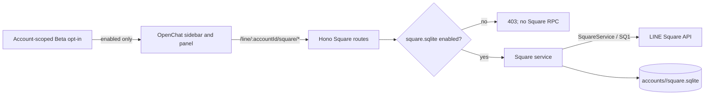

# OpenChat / Square (Beta)

Last updated: 2026-11-04

## Status

OpenChat support is Beta. Vyline makes no Square requests until the user enables **OpenChat** in Settings > Beta Features and records consent. While disabled, only the local account-scoped SQLite flag is read.

The current implementation lists joined OpenChats/rooms, searches OpenChats, fetches messages for the selected room, and sends text. It uses a separate `/SQ1` BFF path, UI, and database from regular Talk `/S4`, Chat, Message, and read-state code.

Joining/leaving, administrative actions, room settings, thread navigation/replies, note publishing, media, read receipts, reactions, live talk, and LIFF are not exposed. A name in the protocol types or HAR does not establish a safe UI flow, permissions, or regional behavior. `ADMIN`, `CO_ADMIN`, and `MEMBER` role enums exist, but the current responses do not yet identify the current user's role with sufficient confidence. Owner and co-owner crowns are therefore not shown yet.

## Data flow

Square identifiers never enter the regular Talk chat/message model or Talk API. Room IDs (`squareChatMid`) and parent Square IDs (`squareMid`) remain distinct.

## Opt-in and network schedule

- New accounts default to `square_settings.enabled=0`.
- The account-scoped SQLite flag is enabled only after the device consent ledger is saved.
- Enabling immediately fetches the joined list. While the app is visible, the list refreshes at most every five minutes.
- A room's events are requested when that room is opened and then every 60 seconds while visible. Other rooms are not scanned in the background.
- Disabling updates the backend flag and generation first. An already dispatched HTTP/RPC call may not be cancellable, but its response is discarded and cannot write to the database or UI; no new Square calls are scheduled.
- Consent history stays in the existing local Beta ledger. Cached content may include messages and profiles, so protect the device and its user account.

## APIs and capabilities

| Capability | Status | Behavior |
| --- | --- | --- |
| Enable status | Implemented | `GET /line/:accountId/square/status` reads local config only |
| Enable / disable | Implemented | Changes the account SQLite flag; generation invalidates in-flight responses |
| Joined list | Implemented | Bounded pagination through `/SQ1` `getJoinedSquares` and `getJoinedSquareChats` |
| OpenChat search | Implemented | `/SQ1` `searchSquares`, query length 2–100, 20 results, one-second server-side interval |
| Room messages | Partial | `/SQ1` `fetchSquareChatEvents`, at most five pages per call, persisted continuation |
| Text send | Implemented | `/SQ1` `sendMessage`, 1.25-second per-room cooldown and SQLite operation UUID |
| Attachments / stickers | Not supported | Square-specific send and media flows need verification |
| Threads / subrooms | Not supported | Types and event fields exist, but parent relationships and history boundaries lack fixture-backed confirmation |
| Read / reactions | Not supported | Square APIs exist; UI actions and reconciliation are not implemented |
| Roles / authority | Not supported | Enums and authority APIs exist; self-role mapping is unverified |
| Notes | Not supported | Square Notes must not be confused with LINE Timeline Notes; the HAR OpenNote path needs separate analysis |
| Join / leave / admin | Not supported | Confirmation UI, permissions, and recovery behavior remain unverified |
| Live talk | Not supported | Protocol types do not establish a verified UI flow |
| LIFF | Not supported | No assumption that LIFF works inside OpenChat |
| E2EE | Unverified | No Talk E2EE decrypt path was found in the Square message class; do not guess how to decrypt |

## Sync, deduplication, and deletion

- Per-room `sync_cursor` and `continuation_token` are stored separately. The durable cursor does not advance while pages remain; the next request resumes from the continuation.
- Message identity is `(room_id, message_id)`. An UPSERT with an older Square message revision cannot replace a newer stored revision.
- Destroy events create `(room_id, message_id)` tombstones, preventing older history pages from resurrecting deleted messages.
- Messages are written before the cursor. If the process crashes before cursor advancement, replay is idempotent by message ID.
- Square cursor and continuation semantics are not a published LINE contract, and long-running live-account tests have not been done. Resuming backlogs over five pages and gap-free page boundaries still need fixture tests and an optional test account.

## Database and backups

Each account uses `data/accounts/<safe-account-id>/square.sqlite`, separate from normal chat storage. Main tables:

- `square_settings`: Beta state
- `square_entities`: Square / room / member JSON cache
- `square_messages`: message cache keyed by room ID and Square message ID
- `square_message_tombstones`: prevent resurrection after deletion
- `square_room_sync_state`: per-room cursor and continuation token
- `square_send_rate`, `square_send_operations`: room send pacing and duplicate-operation prevention; message text is not stored here

WAL mode and `synchronous=NORMAL` are used. Compatibility with normal VylineBackup, iOS restore, and Desktop restore has not been verified, so the Square database is currently excluded from those backups. History reads and sends accept only room IDs present in the locally cached joined-room list.

## Rate protection

LINE's published Messaging API limits do not define the private `/SQ1` Square RPC limits. Vyline applies a local safety policy: at most one send per room every 1.25 seconds; sends in different rooms are not globally serialized. A client operation UUID is reserved in SQLite before the request, so retrying the same operation after a lost HTTP response cannot send it twice. Search requests have a one-second per-account minimum interval.

These are Vyline safeguards, not LINE-published thresholds or a way to bypass limits. On server errors or restriction responses, reduce retries and disable the feature if the account is affected.

## Regions, official references, and HAR

LINE's official Help Center lists **Japan, Taiwan, and Thailand** as OpenChat regions. Do not describe OpenChat as Japan-only. The supplied HAR was captured from a single Japanese `uts-front.line-apps.com` session and does not establish Vyline compatibility in Taiwan or Thailand. Those regions remain untested; accounts or fixture PRs for validation are welcome.

The HAR is about 98 MB and is not committed. Analysis records only endpoint families and aggregate key names; it excludes cookies, tokens, user identifiers, message text, and URL query values. Finding `LIFF1` traffic does not prove that it belongs to OpenChat settings. LINE Developers says LIFF apps are not officially supported inside OpenChat.

References:

- [LINE OpenChat guide](https://guide.line.me/ja/services/openchat.html)
- [LINE Help: OpenChat availability](https://help.line.me/line/smartphone?a8=.V&contentId=20014753&lang=en)
- [LINE Help: OpenChat subchats and sync](https://help.line.me/line/?contentId=20024116&lang=ja)
- [LINE Developers: LIFF overview and OpenChat limitation](https://developers.line.biz/ja/docs/liff/overview/)
- [LINE Developers: Messaging API rate limits](https://developers.line.biz/en/tips/2026/09/10/messaging-api-rate-limits/) — this does not publish Square RPC limits

## Rollback

Turn OpenChat Beta off to stop future Square traffic. When rolling back to a version that does not understand this schema, keep `square.sqlite`; do not delete it. There is no user-facing cache deletion control or API. If manually removing the cache, exit the app and handle the DB, WAL, and SHM files together.
