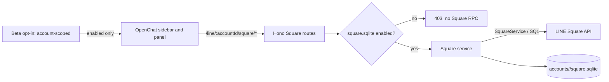

# OpenChat / Square（Beta）

最終更新: 2026-11-04

## 状態

OpenChat 対応は Beta です。設定 > ベータ機能で「OpenChatを有効にする」に同意・切替するまで、Vyline は Square の通信を開始しません。無効時に許可されるのは、アカウント別 SQLite のローカル設定状態を読む処理だけです。

現在の実装は、参加中の OpenChat / ルーム一覧、OpenChat 内の検索、選択したルームのメッセージ取得・テキスト送信です。通常トークの Talk `/S4`・Chat・Message・既読処理とは別の `/SQ1` BFF 経路、別 UI、別 DB を使います。

この実装は、参加中ルームの閲覧・テキスト送信に加えて、HARとprotocol実装を照合したスレッド閲覧・テキスト返信、メンバー役職表示、画像/動画/音声の遅延プレビューに対応します。メディア添付送信、ノート本文、既読通知、リアクション、役職・管理操作、ライブトーク、ルーム参加/退出は未対応です。OpenChatの「スレッド」と通常ルームの「サブルーム」は同一機能と確認できていないため、画面ではスレッドのみを扱います。

## データフロー

通常トークのメッセージ一覧へ Square の ID を混ぜません。ルーム ID は `squareChatMid`、親 Square ID は `squareMid` として別の名前空間に保存します。Square ID の見た目が LINE MID に似ていても、Talk API には渡しません。

## 有効化と通信頻度

- 新規アカウントは SQLite の `square_settings.enabled=0` です。
- Beta 設定の同意履歴を書き込めた後にだけ、アカウント別 SQLite の有効フラグを ON にします。
- 有効化直後に参加中一覧を取得します。表示中のアプリは可視状態のとき最大 5 分ごとに一覧を更新します。
- メッセージ API はルームを開いた時に呼び出し、そのルームだけを可視状態で 60 秒ごとに差分取得します。他のルームをバックグラウンドで走査しません。
- 無効化はまずバックエンドのフラグと世代番号を更新します。すでに送信済みの HTTP/RPC はキャンセルできない場合がありますが、応答を破棄し、後続の DB 書込・UI 反映・新規 RPC を止めます。
- OpenChat Beta の同意ログは既存の端末内 Beta consent ledger に保存します。キャッシュにはメッセージ・プロフィール等が含まれるため、端末ユーザーと端末の保護が必要です。

## API と現在の機能

| 機能 | 実装 | 現在の動作 |
| --- | --- | --- |
| 有効状態 | 実装 | `GET /line/:accountId/square/status` はローカル設定のみ参照 |
| 有効化 / 無効化 | 実装 | ローカル SQLite のフラグを更新。無効化時は世代番号で処理中応答を破棄 |
| 参加中一覧 | 実装 | `/SQ1` `getJoinedSquares` と `getJoinedSquareChats` を上限付きでページ取得 |
| OpenChat 検索 | 実装 | `/SQ1` `searchSquares`、2〜100 文字、結果 20 件、サーバー側 1 秒間隔制限 |
| ルーム履歴 | 部分実装 | `/SQ1` `fetchSquareChatEvents`、1 回最大 5 ページ、継続トークン保存 |
| テキスト送信 | 実装 | `/SQ1` `sendMessage`。ルームごと 1.25 秒間隔、操作 UUID を SQLite に記録 |
| スレッド閲覧・返信 | 部分実装 | 親メッセージに記録された `threadInfo.chatThreadMid` のみ開く。`getSquareThread` で本人が `JOINED` の場合に限り `sendSquareThreadMessage` を許可。ルームごとの送信間隔と操作 UUID 重複防止を共有 |
| メンバー・役職 | 読み取り実装 | `getSquareChatMembers` を100件ずつ取得し、SQLiteへアカウント・ルーム別に保存。`ADMIN`は青い王冠、`CO_ADMIN`は反転した王冠で表示。管理操作はなし |
| 画像・動画・音声プレビュー | 部分実装 | `SquareMessage`の`isSquare` OBS経路を利用し、可視範囲へ近づいた時だけ取得。取得後8 MiB超を表示前に拒否するが、転送・メモリ確保前のサイズ上限ではない。URLメタデータはフェッチしない |
| ファイル・スタンプ送信 | 未対応 | Square 用送信経路の検証が必要 |
| 既読・リアクション | 未対応 | Square 専用 API はあるが、UI 操作・状態同期はまだ実装していない |
| 役職・権限操作 | 部分実装 | メンバー一覧の`SquareMember.role`のみ表示。HARで取得APIを3回確認。権限変更・本人の管理者権限操作は未実装 |
| ノート | 未対応 | HARで`getNoteStatus`を1回確認。これはノート状態取得の証拠で、本文取得・投稿の全フローは確認できていない。OpenNote系HTTP通信をSquare Note APIと同一視しない |
| 参加・退出・管理 | 未対応 | 状態変更前の確認 UI、エラー復旧、権限条件を未確認 |
| ライブトーク | 未対応 | 対応を示す protocol 型があっても画面フローは未検証 |
| LIFF | 未対応 | OpenChat 内で LIFF が公式サポートされる前提は置かない |
| E2EE | 未確認 | Square メッセージクラスに Talk E2EE 復号経路が見つからない。暗号化状態を仮定して復号しない |

### HARで確認したスレッド通信

提供された約98 MBのHARを、protocol packageのThrift decoderでローカル解析しました。値はレポートに出さず、要求/応答のフィールド名とRPC名だけを照合しています。

- `/SQ1` の `sendSquareThreadMessage` は7回。要求は `reqSeq`、`chatMid`、`threadMid`、`threadMessage.message` を持ち、テキストでは `to`、`text`、`contentType`（`NONE`）、`toType`（`SQUARE_THREAD`）が記録されていました。応答は `createdThreadMessage` を返します。
- `getSquareThread`、`getSquareThreadMid`、`joinSquareThread`、`leaveSquareThread`、`markThreadsAsRead` も各1回観測しました。`getSquareThread`の応答に`myThreadMember`が含まれるため、送信前に参加状態を照合します。
- `getSquareChatMembers`は3回観測し、応答型は`SquareMember[]`でroleを持ちます。公式ヘルプでは作成者が管理者、管理者は共同管理者へ権限を移譲可能と説明されています。よってADMIN/CO_ADMINは表示にだけ使い、権限変更RPCは呼びません。
- `fetchSquareChatEvents`の復号可能な応答から`IMAGE` 8件、`VIDEO` 0件、`AUDIO` 1件、`FILE` 1件、`STICKER` 11件などのcontent typeを確認しました。画像/動画/音声の表示経路はProtocolのSquare OBS download APIを使い、Square本文に入った任意URLは取得しません。HARで型が見つかったことは、各メディア形式のダウンロード成功を意味しません。
- Vylineの既存 `SquareThreadMessage` 実装がHARの送信構造と一致することを確認し、同じreqseq取得・本文構造を使います。未参加スレッドへの自動参加はしません。送信本文はテキストだけです。
- HARは単一セッションの記録であり、別アカウント・地域・スレッド状態のサーバー応答を保証しません。実ユーザーへ送信する検証やHARリプレイはしていません。
- Squareメッセージ一覧は`(room_id, message_id)`で共通重複排除し、スレッドの同期カーソル/継続トークンはルーム本体とは別キーで管理します。

## 同期・重複排除・取消し

- ルームイベントは `square_room_sync_state` の `sync_cursor` と `continuation_token` に分けて記録します。ページが残っている場合は同期 cursor を進めず、次回は continuation から再開します。
- メッセージの重複キーは `(room_id, message_id)` です。Square メッセージ revision が古い UPSERT は既存の新しい revision を上書きしません。
- 取消しイベントは `(room_id, message_id)` tombstone に記録し、過去ページの再取得でもメッセージを復活させません。
- メッセージを SQLite に書いた後で cursor を更新します。書込途中のクラッシュは同じメッセージ ID の UPSERT で再適用できます。
- Square の event cursor / continuation の意味は LINE 公開仕様ではなく、実アカウントの長期同期試験も未実施です。最大 5 ページを超えた backlog の再開、ページ境界の欠落がないことは引き続き fixtures と任意のテストアカウントで検証してください。

## DB とバックアップ

各アカウントの `data/accounts/<safe-account-id>/square.sqlite` に保存し、通常トークの Chat DB と分離します。主なテーブルは次のとおりです。

- `square_settings`: Beta の有効状態
- `square_entities`: Square / room / member の JSON キャッシュ
- `square_messages`: room ID と Square message ID を主キーにした本文キャッシュ
- `square_message_tombstones`: 取消しの再出現防止
- `square_room_sync_state`: ルームごとの cursor と continuation token
- `square_send_rate`, `square_send_operations`: ルーム単位の送信間隔と重複操作防止。本文は保存しない

WAL と `synchronous=NORMAL` を利用します。Square DB を通常の VylineBackup / iOS・Desktop 復元に含める互換性はまだ検証していないため、現在のバックアップには含めません。履歴取得・送信は、ローカルにキャッシュされた参加中ルーム一覧に含まれる ID だけ受け付けます。

## レート保護

LINE が公開している Messaging API の rate limit は、非公開の `/SQ1` Square RPC の公称上限ではありません。Vyline の安全策として、同じルームの送信は 1.25 秒に 1 回、異なるルーム間はグローバル直列化しません。送信時に client operation UUID を SQLite へ予約し、HTTP 応答が失われた場合に同一 UUID を再実行して二重送信することを防ぎます。検索はアカウントごとに最低 1 秒間隔です。

これは LINE の許可値や制限値を意味せず、運用で制限を回避する設計でもありません。サービス側のエラー・制限応答では再試行を抑え、アカウントに問題が出る場合は機能を OFF にしてください。

## 地域・公式資料・HAR

LINE の公式ヘルプでは OpenChat の利用地域は **日本・台湾・タイ** とされています。「日本のみ」とは記載しません。今回の HAR は日本の `uts-front.line-apps.com` で取得された単一セッション由来で、台湾・タイの Vyline 動作を示しません。台湾・タイのアカウントで未検証です。検証協力アカウントまたは protocol fixtures の PR を歓迎します。

HAR は約 98 MB のため、リポジトリには含めません。解析記録には endpoint family とキー名の集計のみを使い、Cookie、token、ユーザー ID、本文、URL query 値は記録しません。`LIFF1` の通信が見つかったことだけでは Square の設定フローである根拠になりません。LINE Developers は LIFF app を OpenChat 内で公式サポートしないと明記しています。

参照:

- [LINE OpenChat ガイド](https://guide.line.me/ja/services/openchat.html)
- [LINE ヘルプ: OpenChat の利用地域](https://help.line.me/line/smartphone?a8=.V&contentId=20014753&lang=en)
- [LINE ヘルプ: OpenChat のサブトークと同期](https://help.line.me/line/?contentId=20024116&lang=ja)
- [LINE ヘルプ: OpenChat 管理者向けの権限](https://help.line.me/line/?contentId=20005393&lang=ja)
- [LINE ヘルプ: トークのノート](https://help.line.me/line/?contentId=20000246&lang=ja)
- [LINE Developers: LIFF 概要と OpenChat の制約](https://developers.line.biz/ja/docs/liff/overview/)
- [LINE Developers: Messaging API rate limits](https://developers.line.biz/en/tips/2026/09/10/messaging-api-rate-limits/) — Square RPC の制限値を示す資料ではありません

## 変更の戻し方

OpenChat 通信を停止するには設定で Beta を OFF にします。DB スキーマを使わない旧版へ戻す場合も `square.sqlite` は削除せず残してください。ユーザー向けキャッシュ削除 UI/API はありません。手動で削除する場合はアプリを終了し、DB/WAL/SHM を一式で扱ってください。
