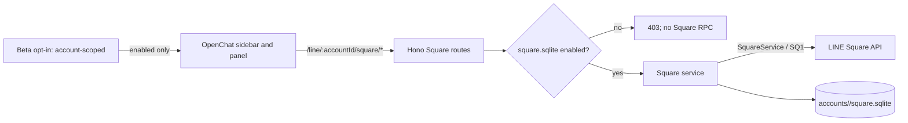

# OpenChat / Square（Beta）

最終更新: 2026-11-05

## 状態

OpenChat 対応は Beta です。設定 > ベータ機能で「OpenChatを有効にする」に同意・切替するまで、Vyline は Square の通信を開始しません。無効時に許可されるのは、アカウント別 SQLite のローカル設定状態を読む処理だけです。

通常トークの Talk `/S4`・Chat・Message・既読処理とは別の `/SQ1` BFF 経路、別 UI、別 DB を使います。HARに記録されたRPCと、実装にはあるがHARで観測できなかったRPCを区別します。後者はHARに基づく確定仕様とは扱いません。

この実装は、参加中ルームの閲覧・テキスト/スタンプ送信、スレッド閲覧・テキスト返信、メンバー役職表示、画像/動画/音声の遅延プレビュー、手動既読、標準リアクション、非公開ルーム作成に対応します。以下の機能表で、LINE公式アプリの端末対応とVylineの実装状況を別々に示します。メディア添付送信、ノート本文、役職変更などの管理操作、ライブトーク、ルーム参加/退出は未対応または通信仕様未確定です。OpenChatの「スレッド」と通常ルームの「サブルーム」は別機能として扱います。

## データフロー



通常トークのメッセージ一覧へ Square の ID を混ぜません。ルーム ID は `squareChatMid`、親 Square ID は `squareMid` として別の名前空間に保存します。Square ID の見た目が LINE MID に似ていても、Talk API には渡しません。

## 有効化と通信頻度

- 新規アカウントは SQLite の `square_settings.enabled=0` です。
- Beta 設定の同意履歴を書き込めた後にだけ、アカウント別 SQLite の有効フラグを ON にします。
- 有効化直後に参加中一覧を取得します。表示中のアプリは可視状態のとき最大 5 分ごとに一覧を更新します。
- メッセージ API はルームを開いた時に呼び出し、そのルームだけを可視状態で 60 秒ごとに差分取得します。他のルームをバックグラウンドで走査しません。
- 無効化はまずバックエンドのフラグと世代番号を更新します。すでに送信済みの HTTP/RPC はキャンセルできない場合がありますが、応答を破棄し、後続の DB 書込・UI 反映・新規 RPC を止めます。
- OpenChat Beta の同意ログは既存の端末内 Beta consent ledger に保存します。キャッシュにはメッセージ・プロフィール等が含まれるため、端末ユーザーと端末の保護が必要です。

## API と現在の機能

| 機能 | 実装 | 現在の動作 |
| --- | --- | --- |
| 有効状態 | 実装 | `GET /line/:accountId/square/status` はローカル設定のみ参照 |
| 有効化 / 無効化 | 実装 | ローカル SQLite のフラグを更新。無効化時は世代番号で処理中応答を破棄 |
| OpenChat 作成 | 実装 | HARに1回記録された `/SQ1` `createSquare` を使用。検索非表示・参加コード方式に限定し、`createSquare` 応答から返る既定ルームを同じアカウントの `square.sqlite` へ保存 |
| 参加中一覧 | 一部未検証 | 現実装は `/SQ1` `getJoinedSquares` / `getJoinedSquareChats` を使用するが、対象HARではどちらも0回。HARで確認済みの手順とは言えない。`fetchMyEvents`だけで完全な初期一覧を復元できるかは未確定 |
| OpenChat 検索 | 一部未検証 | 現実装は `/SQ1` `searchSquares` を使用するが、対象HARでは0回。Webの `/sf/main/search` は `text/x-component` のNext.js RSC応答で、安定したJSON APIとして扱わない |
| ルーム履歴 | 部分実装 | `/SQ1` `fetchSquareChatEvents`、1 回最大 5 ページ、継続トークン保存 |
| テキスト送信 | 実装 | `/SQ1` `sendMessage`。ルームごと 1.25 秒間隔、操作 UUID を SQLite に記録 |
| スレッド閲覧・返信 | 部分実装 | 親メッセージに記録された `threadInfo.chatThreadMid` のみ開く。`getSquareThread` で本人が `JOINED` の場合に限り `sendSquareThreadMessage` を許可。ルームごとの送信間隔と操作 UUID 重複防止を共有 |
| メンバー・役職 | 読み取り実装 | `getSquareChatMembers` を100件ずつ取得し、SQLiteへアカウント・ルーム別に保存。`ADMIN`は青い王冠、`CO_ADMIN`は反転した王冠で表示。管理操作はなし |
| 画像・動画・音声プレビュー | 部分実装 | `SquareMessage`の`isSquare` OBS経路を利用し、可視範囲へ近づいた時だけ取得。取得後8 MiB超を表示前に拒否するが、転送・メモリ確保前のサイズ上限ではない。URLメタデータはフェッチしない |
| スタンプ | 送受信対応 | HARで受信`STICKER` 11件、送信スタンプ5件と5件すべての成功応答を確認。送信は既存所持スタンプ選択UIからSquare専用APIへ接続し、1.25秒間隔・operation UUID重複防止を共有。受信は固定CDN・数値ID検証で描画 |
| ファイル・画像/動画/音声送信 | 未対応 | Protocolに画像/動画/音声の送信メソッドがあるが、HARでSquare由来のアップロードを特定できず、ファイル送信仕様も未確認。受信ファイルの安全な取得経路も未実装 |
| 既読 | 手動送信を追加 | メッセージごとの明示ボタンから`markAsRead`を呼ぶ。スレッドでは`threadMid`も渡す。自動既読・未読数/位置との統合はしない。HARには`markAsRead`72件と`markThreadsAsRead`1件があるが、完全な既読位置同期は未確認 |
| リアクション | 手動送信を追加 | メッセージごとに標準6種を選んで`reactToMessage`を呼ぶ。対象がキャッシュ内の同じルーム/スレッドに属することを確認する。件数・読者一覧の表示、解除操作、イベントとの状態統合は未実装。HARでは要求3件を確認したが全応答/状態遷移は未確認 |
| 役職・権限操作 | 部分実装 | メンバー一覧の`SquareMember.role`のみ表示。HARで`updateSquareMember` 11件、`updateSquareChatMember` 6件を確認したが操作目的を確定できないため管理操作は未実装 |
| ノート | 未対応 | HARで`getNoteStatus`を1回確認。Protocol型が示すのは状態情報までで、本文取得・投稿の全フローは未確認。OpenNote系HTTP通信をSquare Note APIと同一視しない |
| 参加・退出・管理 | 未対応 | HARで`getJoinableSquareChats` 5件、`leaveSquareChat` 1件、`joinSquareChat` 0件、別操作`joinSquare` 1件を確認。参加条件、退出要求値、承認・失敗復旧を未検証 |
| ライブトーク | 未対応 | HARに`/SQLV1`通信はなく、`/SQ1`でも関連RPCなし。Protocolに別サービスの型・呼び出し口があるだけではOpenChat向け通信契約や音声経路を確認できない |
| LIFF | 未対応 | OpenChat 内で LIFF が公式サポートされる前提は置かない |
| E2EE | 未確認 | Square メッセージクラスに Talk E2EE 復号経路が見つからない。暗号化状態を仮定して復号しない |

### HARで確認したスレッド通信

### HARを基準にした通信監査

2026-11-04に提供されたHARをローカルで解析しました。全5,303リクエスト中、`/SQ1` は1,088件で、Thrift compact protocolのメソッド名を1,088件すべて復号できました。HARの値（認証情報、識別子、本文、招待情報）は資料やログに転記していません。

| RPC | 件数 | Vylineでの扱い |
| --- | ---: | --- |
| `fetchMyEvents` | 312 | HAR確認。現実装では主にprotocol側poller。初期一覧の完全な代替とは未確認 |
| `fetchSquareChatEvents` | 482 | HAR確認。ルーム履歴・差分取得 |
| `markAsRead` / `markThreadsAsRead` | 72 / 1 | HAR確認。通常ルームの手動既読経路は接続済み。全状態同期は未確認 |
| `sendMessage` / `sendSquareThreadMessage` | 52 / 7 | HAR確認。通常ルーム送信およびスレッド送信の根拠 |
| `createSquare` / `createSquareChat` | 1 / 1 | HAR確認。Vylineからの新規作成は`createSquare`で、レスポンスに既定ルームが返ることを検証 |
| `getJoinedSquares` / `getJoinedSquareChats` / `searchSquares` | 0 / 0 / 0 | HAR未観測。実装・protocolに存在することだけではHAR根拠にならない |

他の `/SQ1` RPC もHARで観測しました。メソッド別の全件数と、各RPCの要求/応答フィールドは今後の実装根拠としてHARとprotocol型を併記して確認してください。HTTP status 200だけではRPC成功を意味しません。HARにはThrift例外応答も含まれていました。

全44メソッドの出現件数（HARの要求名のみを集計、要求値は非表示）:

```text
createSquare 1 · createSquareChat 1 · createSquareChatAnnouncement 2 · deleteSquareChat 2 · deleteSquareChatAnnouncement 1
destroyMessages 1 · fetchMyEvents 312 · fetchSquareChatEvents 482 · findSquareByEmid 3 · getCategories 7
getInvitationTicketUrl 3 · getJoinableSquareChats 5 · getNoteStatus 1 · getSquare 1 · getSquareChatAnnouncements 6
getSquareChatMembers 3 · getSquareEmid 1 · getSquareMember 11 · getSquareMembersBySquare 7 · getSquareStatus 25
getSquareThread 1 · getSquareThreadMid 1 · hideSquareMemberContents 1 · joinSquare 1 · joinSquareThread 1
leaveSquareChat 1 · leaveSquareThread 1 · markAsRead 72 · markThreadsAsRead 1 · reactToMessage 3
removeSubscriptions 12 · reportSquare 1 · reportSquareMember 2 · searchSquareChatMembers 3 · searchSquareChatMentionables 5
searchSquareMembers 5 · sendMessage 52 · sendSquareThreadMessage 7 · unhideSquareMemberContents 1 · unsendMessage 5
updateSquare 2 · updateSquareChat 18 · updateSquareChatMember 6 · updateSquareMember 5 · updateSquareMembers 6
```

OpenChat公開サイトの `/sf/main/search`、`/sf/main/category/0`、`/sf/main/live-talks` はHAR上で `text/x-component`（Next.js RSC）として返っていました。画面用の内部転送形式なので、安定した一覧APIとして新規実装に採用しません。Square JSON RESTの`/smw/api/v2p/sm/square`や`/squares/similar`はHARに存在しますが、参加中一覧APIではありません。

このため、現時点で「一覧・検索もHARに実例があるAPIで確定済み」とは扱えません。HAR記録が必要なRPCを追加採取するまでは、一覧・検索の現行実装に依存する範囲を明示し、取得不能時に誤った空一覧へ置き換えないようにします。

提供された約98 MBのHARを、protocol packageのThrift decoderでローカル解析しました。値はレポートに出さず、要求/応答のフィールド名とRPC名だけを照合しています。

- `/SQ1` の `sendSquareThreadMessage` は7回。要求は `reqSeq`、`chatMid`、`threadMid`、`threadMessage.message` を持ち、テキストでは `to`、`text`、`contentType`（`NONE`）、`toType`（`SQUARE_THREAD`）が記録されていました。応答は `createdThreadMessage` を返します。
- `getSquareThread`、`getSquareThreadMid`、`joinSquareThread`、`leaveSquareThread`、`markThreadsAsRead` も各1回観測しました。`getSquareThread`の応答に`myThreadMember`が含まれるため、送信前に参加状態を照合します。
- `getSquareChatMembers`は3回観測し、応答型は`SquareMember[]`でroleを持ちます。公式ヘルプでは作成者が管理者、管理者は共同管理者へ権限を移譲可能と説明されています。よってADMIN/CO_ADMINは表示にだけ使い、権限変更RPCは呼びません。
- `fetchSquareChatEvents`の復号可能な応答から`IMAGE` 8件、`VIDEO` 0件、`AUDIO` 1件、`FILE` 1件、`STICKER` 11件などのcontent typeを確認しました。画像/動画/音声の表示経路はProtocolのSquare OBS download APIを使い、Square本文に入った任意URLは取得しません。HARで型が見つかったことは、各メディア形式のダウンロード成功を意味しません。
- Vylineの既存 `SquareThreadMessage` 実装がHARの送信構造と一致することを確認し、同じreqseq取得・本文構造を使います。未参加スレッドへの自動参加はしません。送信本文はテキストだけです。
- HARは単一セッションの記録であり、別アカウント・地域・スレッド状態のサーバー応答を保証しません。実ユーザーへ送信する検証やHARリプレイはしていません。
- Squareメッセージ一覧は`(room_id, message_id)`で共通重複排除し、スレッドの同期カーソル/継続トークンはルーム本体とは別キーで管理します。

## 同期・重複排除・取消し

- ルームイベントは `square_room_sync_state` の `sync_cursor` と `continuation_token` に分けて記録します。ページが残っている場合は同期 cursor を進めず、次回は continuation から再開します。
- メッセージの重複キーは `(room_id, message_id)` です。Square メッセージ revision が古い UPSERT は既存の新しい revision を上書きしません。
- 取消しイベントは `(room_id, message_id)` tombstone に記録し、過去ページの再取得でもメッセージを復活させません。
- メッセージを SQLite に書いた後で cursor を更新します。書込途中のクラッシュは同じメッセージ ID の UPSERT で再適用できます。
- Square の event cursor / continuation の意味は LINE 公開仕様ではなく、実アカウントの長期同期試験も未実施です。最大 5 ページを超えた backlog の再開、ページ境界の欠落がないことは引き続き fixtures と任意のテストアカウントで検証してください。

## DB とバックアップ

各アカウントの `data/accounts/<safe-account-id>/square.sqlite` に保存し、通常トークの Chat DB と分離します。主なテーブルは次のとおりです。

- `square_settings`: Beta の有効状態
- `square_entities`: Square / room / member の JSON キャッシュ
- `square_messages`: room ID と Square message ID を主キーにした本文キャッシュ
- `square_message_tombstones`: 取消しの再出現防止
- `square_room_sync_state`: ルームごとの cursor と continuation token
- `square_send_rate`, `square_send_operations`: ルーム単位の送信間隔と重複操作防止。本文は保存しない

WAL と `synchronous=NORMAL` を利用します。Square DB を通常の VylineBackup / iOS・Desktop 復元に含める互換性はまだ検証していないため、現在のバックアップには含めません。履歴取得・送信は、ローカルにキャッシュされた参加中ルーム一覧に含まれる ID だけ受け付けます。

## レート保護

LINE が公開している Messaging API の rate limit は、非公開の `/SQ1` Square RPC の公称上限ではありません。Vyline の安全策として、同じルームの送信は 1.25 秒に 1 回、異なるルーム間はグローバル直列化しません。送信時に client operation UUID を SQLite へ予約し、HTTP 応答が失われた場合に同一 UUID を再実行して二重送信することを防ぎます。検索はアカウントごとに最低 1 秒間隔です。

これは LINE の許可値や制限値を意味せず、運用で制限を回避する設計でもありません。サービス側のエラー・制限応答では再試行を抑え、アカウントに問題が出る場合は機能を OFF にしてください。

## 対象地域・公式資料・HAR

今回の調査・実装対象は日本向けの公開資料と提供HARに限定します。台湾・タイの仕様・動作・互換性は依頼により対象外であり、対応済みとは扱いません。

### セカンダリデバイスの機能対応

以下は2026-11-05に確認した**LINE公式アプリの操作案内**です。公式ヘルプにWindows/MacまたはiPad/Androidの操作手順がある場合を「案内あり」とします。「対象外」はChromeセカンダリについて公式ページが明記した制限です。公式アプリで利用できることは、Vylineの非公開 `/SQ1` RPCが同じ端末モードで成功する保証ではありません。

| 機能 | Windows/Macサブ端末 | iPad/Androidサブ端末 | Chromeサブ端末 | Vylineの現状 |
|---|---|---|---|---|
| OpenChatの利用・検索・参加・招待 | 案内あり | 案内あり | 対象外 | 参加中一覧/検索APIはHAR未観測。検索は未検証 |
| OpenChat作成 | 案内あり | 案内あり | 対象外 | HARで`createSquare`を確認。非公開・参加コード方式のみ実装 |
| OpenChatごとのプロフィール変更 | 案内あり | 案内あり | 対象外 | 未実装。プロフィールAPI・更新権限を未検証 |
| 招待リンク/QRの共有 | 案内あり | 案内あり | 対象外 | HARで`getInvitationTicketUrl`を確認。発行条件・失効・安全な表示を未検証 |
| ルーム情報の編集・参加方式設定 | 案内あり | 案内あり | 対象外 | 未実装。HARの更新RPCは目的/引数を確定できず |
| 共同管理者・権限管理 | 案内あり | 案内あり | 対象外 | 役職表示のみ。更新操作は未実装 |
| 参加申請の承認/拒否 | 案内あり | 案内あり | 対象外 | 未実装。要求/応答と権限条件の追加確認が必要 |
| 現在のメンバーを強制退会 | 案内あり | 案内あり | 対象外 | 未実装。HARに管理RPCはあるが操作内容を確定できず |
| 直近退会者への強制退会・参加申請取消し | 一部対象外 | 案内あり | 対象外 | 未実装 |
| サブトークルームの作成/管理 | 案内あり | 案内あり | 対象外 | 未実装。通常ルームと異なる構造を要調査 |
| メッセージスレッド | 案内あり | 案内あり | 対象外 | スレッド検出・閲覧・参加・テキスト返信を実装 |
| ルーム内メッセージ送信・削除 | 案内あり | 案内あり | 対象外 | テキスト/スタンプ送信を実装。削除未実装（HARの`unsendMessage`用途は未確定） |
| `@All` | 機能案内あり（端末別記載なし） | 機能案内あり（端末別記載なし） | 記載なし | 未実装。権限と1時間あたりの制約を未検証 |
| ノート閲覧・作成/編集/削除・共有 | 案内あり | 案内あり | 対象外 | 未実装。HARは`getNoteStatus`のみで本文API未確定 |
| OpenChat/投稿/メンバーの通報 | 案内あり | 案内あり | 記載なし | 未実装。実行先・確認UI・応答処理を未検証 |
| 特定メンバーの投稿を自分の端末だけ非表示 | 案内あり | 案内あり | 記載なし | 未実装。HARの`hideSquareMemberContents`等の引数・イベント同期未検証 |
| OpenChat/サブトークルームから退会 | 案内あり | 案内あり | 対象外 | 未実装。退出APIとサブトークルーム階層が未検証 |
| 標準リアクション | 案内あり | 案内あり | 対象外 | 6種の手動リアクションを実装。状態同期は未実装 |
| 未読数の表示設定・OpenChat通知 | 案内あり | 案内あり | 記載なし | Vyline内の未読数・通知設定とは未連携 |
| OpenChatメッセージ要約 | 一部機能案内あり（適用条件あり） | 一部機能案内あり（適用条件あり） | 記載なし | 未実装。LINE側の限定提供機能で、Vylineから呼び出さない |
| ルーム削除（管理者） | 案内あり | 案内あり | 対象外 | 未実装。不可逆性があるため、要求/応答とUI確認が必要 |
| 参加/退出などのシステム通知設定 | 対象外 | 案内あり | 記載なし | 未実装 |
| OpenChat情報の手動同期 | 案内あり | 案内あり | 記載なし | 未実装 |
| OpenChat内のLIFF | 非対応 | 非対応 | 非対応 | LINE DevelopersがOpenChat内LIFFを正式サポートしないため組み込まない |

「案内あり」は利用可否を示す公式アプリの手順であり、APIの公開やサードパーティークライアントの許可・互換性を示すものではありません。検索表示設定は、メインOpenChat設定ページではWindows/MacとiPad/Androidの手順がありますが、サブトークルーム設定ページではスマートフォンのメイン端末限定と記載されています。設定対象が異なるため矛盾と断定せず、要求仕様が固まるまでVylineでは未実装とします。サブ端末の中でも実行環境は同一ではありません。

Vylineプロトコルの既定モードは`IOSIPAD`です。`ANDROIDSECONDARY`、`DESKTOPWIN`、`DESKTOPMAC`も別モードとして存在し、保存済みアカウントのモードはtoken metadataに保持されます。`DESKTOPWIN`/`DESKTOPMAC`は公式Desktopと同じ端末スロットを使うため、公式Desktopとの同時利用に影響します。したがって「セカンダリなら全機能が使える」とは仮定せず、各モード・権限・RPCごとに検証します。

### 端末差の公式参照

- [管理者向け基本機能（作成、共同管理者、権限）](https://help.line.me/line/smartphone?contentId=20005393&lang=ja)
- [参加者向け基本機能（検索、参加、ノート、スレッド）](https://help.line.me/line/smartphone/pc?contentId=20005375&lang=ja)
- [OpenChat設定管理](https://help.line.me/line/smartphone?contentId=20020647&lang=ja)
- [参加メンバー管理](https://help.line.me/line/smartphone?contentId=20005392&lang=ja)
- [メッセージ管理](https://help.line.me/line/smartphone?contentId=20015842&lang=ja)
- [OpenChat削除](https://help.line.me/line/smartphone?contentId=20005403&lang=ja)
- [リアクション](https://help.line.me/line/smartphone?contentId=20020725&lang=ja)
- [OpenChat情報の同期](https://help.line.me/line/?contentId=20024116&lang=ja)
- [サブトークルームの作成と管理](https://help.line.me/line/IOSSecondary/?contentId=20024745&lang=ja)
- [複数端末の種類と制限](https://help.line.me/line/smartphone?contentId=20000132&lang=ja)

公式資料上の通常サブルームとスレッドは別機能です。Vylineが扱うのは、親メッセージから見つけた`chatThreadMid`によるスレッドのみで、サブルーム階層は未分類です。公式ヘルプのスレッド作成・返信可能期間はUIで強制しておらず、送信可否はサーバー応答が最終判断になります。全スレッド一覧・お気に入りも未実装です。LINEはLIFFアプリをOpenChat内で正式サポートしていないため、OpenChat画面からLIFFを起動する機能は追加しません。

HAR は約 98 MB のため、リポジトリには含めません。ローカル読み取り専用集計では合計5,303 request、`/SQ1` 1,088 requestを確認しました。RPC名の集計は`markAsRead` 72、`markThreadsAsRead` 1、`reactToMessage` 3、`getNoteStatus` 1、`getJoinableSquareChats` 5、`joinSquareChat` 0、`leaveSquareChat` 1、`sendSquareThreadMessage` 7でした。スタンプ送信5件は要求metadataに`STKPKGID`、`STKID`、`STKVER`、`STKOPT`があり、全応答で成功を確認しました。要求が記録された事実であり、他の操作の成功・完全な状態遷移・別アカウントでの再現性を示しません。値を出力せず、Cookie、token、ユーザーID、本文、URL query値を記録していません。`LIFF1`の通信が見つかったことだけではSquare設定フローである根拠になりません。LINE DevelopersはLIFF appをOpenChat内で公式サポートしないと明記しています。

参照:

- [LINE OpenChat ガイド](https://guide.line.me/ja/services/openchat.html)
- [LINE ヘルプ: OpenChat の利用地域](https://help.line.me/line/smartphone?a8=.V&contentId=20014753&lang=en)
- [LINE ヘルプ: OpenChat のサブトークと同期](https://help.line.me/line/?contentId=20024116&lang=ja)
- [LINE ヘルプ: スレッド機能](https://help.line.me/line/smartphone?contentId=20027219&lang=ja)
- [LINE ヘルプ: リアクション](https://help.line.me/line/?contentId=20020725&lang=ja)
- [LINE ヘルプ: ライブトーク](https://help.line.me/line?contentId=20024812&lang=ja)
- [LINE ヘルプ: OpenChat 管理者向けの権限](https://help.line.me/line/?contentId=20005393&lang=ja)
- [LINE ヘルプ: トークのノート](https://help.line.me/line/?contentId=20000246&lang=ja)
- [LINE Developers: LIFF 概要と OpenChat の制約](https://developers.line.biz/ja/docs/liff/overview/)
- [LINE Developers: Messaging API rate limits](https://developers.line.biz/en/tips/2026/09/10/messaging-api-rate-limits/) — Square RPC の制限値を示す資料ではありません

## 変更の戻し方

OpenChat 通信を停止するには設定で Beta を OFF にします。DB スキーマを使わない旧版へ戻す場合も `square.sqlite` は削除せず残してください。ユーザー向けキャッシュ削除 UI/API はありません。手動で削除する場合はアプリを終了し、DB/WAL/SHM を一式で扱ってください。
