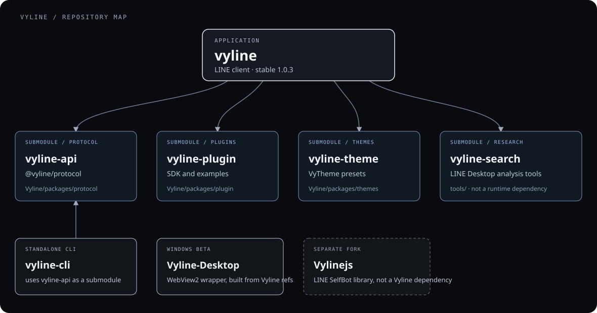

# Vylineの関連リポジトリ

Vyline本体と、プロトコル、テーマ、プラグイン、調査ツールをまとめています。
どのrepoが本体に含まれ、どれが独立しているかを関係図で確認できます。

## 関係図

## リポジトリ

| リポジトリ | 役割 | Vyline本体との関係 |
| --- | --- | --- |
| [vyline](https://github.com/nezumi0627/vyline) | Web、Windows、macOS、Linuxで動くLINEクライアント | アプリ本体。安定版は1.0.3 |
| [vyline-api](https://github.com/nezumi0627/vyline-api) | LINEの認証、プロトコル、暗号化通信を担う `@vyline/protocol` | `Vyline/packages/protocol` のsubmodule |
| [vyline-plugin](https://github.com/nezumi0627/vyline-plugin) | `@vyline/plugin-sdk` とサンプルプラグイン | `Vyline/packages/plugin` のsubmodule |
| [vyline-theme](https://github.com/nezumi0627/vyline-theme) | `@vyline/themes` とVyThemeプリセット | `Vyline/packages/themes` のsubmodule |
| [vyline-search](https://github.com/nezumi0627/vyline-search) | Windows版LINEの調査、unpack、ネイティブシンボル検索 | `tools/` のsubmodule。Vylineの実行時には使わない |
| [vyline-cli](https://github.com/nezumi0627/vyline-cli) | Bunで動く独立したターミナル版LINEクライアント | `vyl` CLIを含むvyline本体とは別repo |
| [Vyline-Desktop](https://github.com/nezumi0627/Vyline-Desktop) | WebView2を使うWindowsデスクトップ検証版 | Vylineの指定refから配布物を組み立てるBeta。通常利用向けではない |
| [Vylinejs](https://github.com/nezumi0627/Vylinejs) | LINE SelfBotを作るJavaScriptライブラリ | `linejs`由来のfork。Vylineクライアントの依存ではない |

## どれから見るか

- Vylineを使う、開発する：[vyline](https://github.com/nezumi0627/vyline)
- プロトコルの実装を見る：[vyline-api](https://github.com/nezumi0627/vyline-api)
- テーマやプラグインを作る：[vyline-theme](https://github.com/nezumi0627/vyline-theme) / [vyline-plugin](https://github.com/nezumi0627/vyline-plugin)
- Windows版LINEの調査ツールを見る：[vyline-search](https://github.com/nezumi0627/vyline-search)

`vyline-api`、`vyline-plugin`、`vyline-theme`、`vyline-search` は本体repoのsubmoduleとして固定したcommitを参照します。
`vyline-cli` と `Vyline-Desktop` は別々に更新・配布するrepoです。
`@vyline/line-types` は本体workspace内のパッケージで、独立repoではありません。
